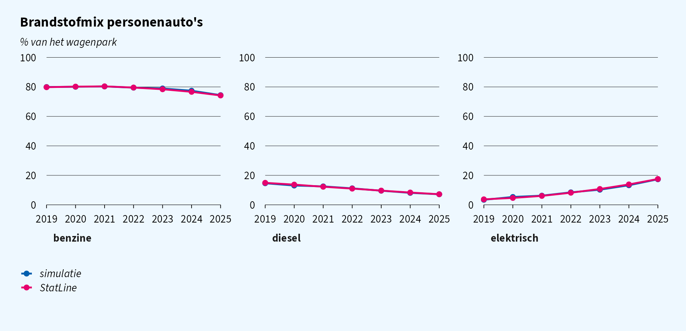
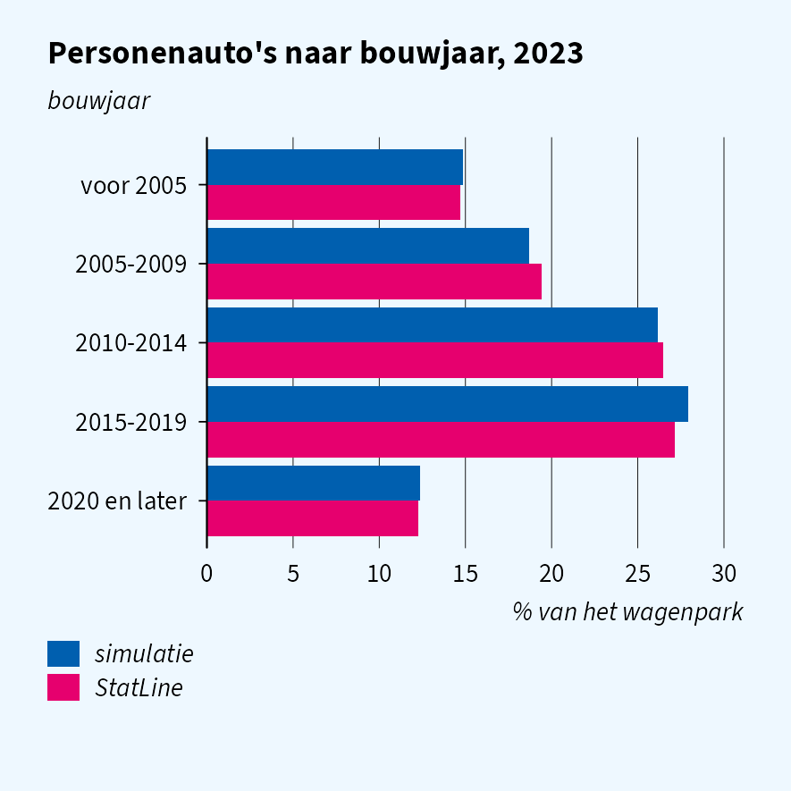
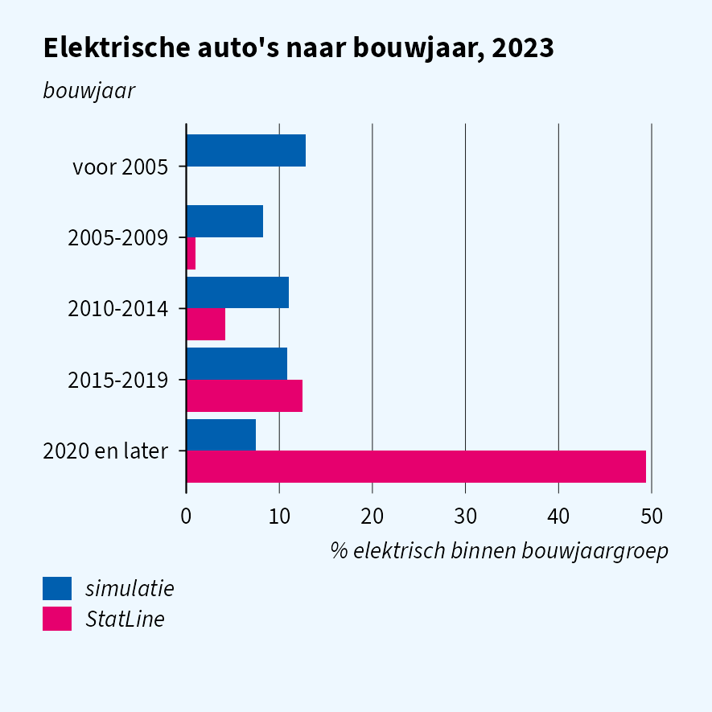
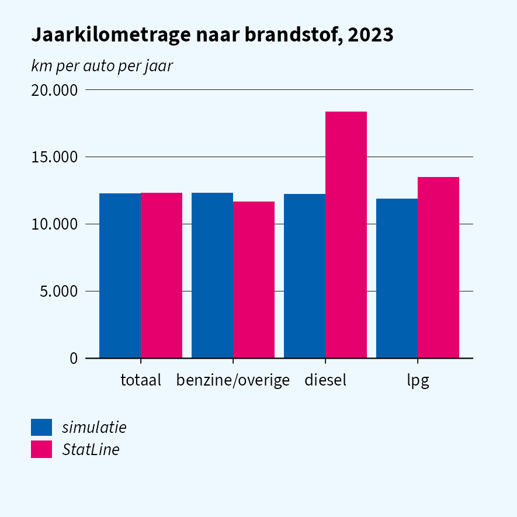
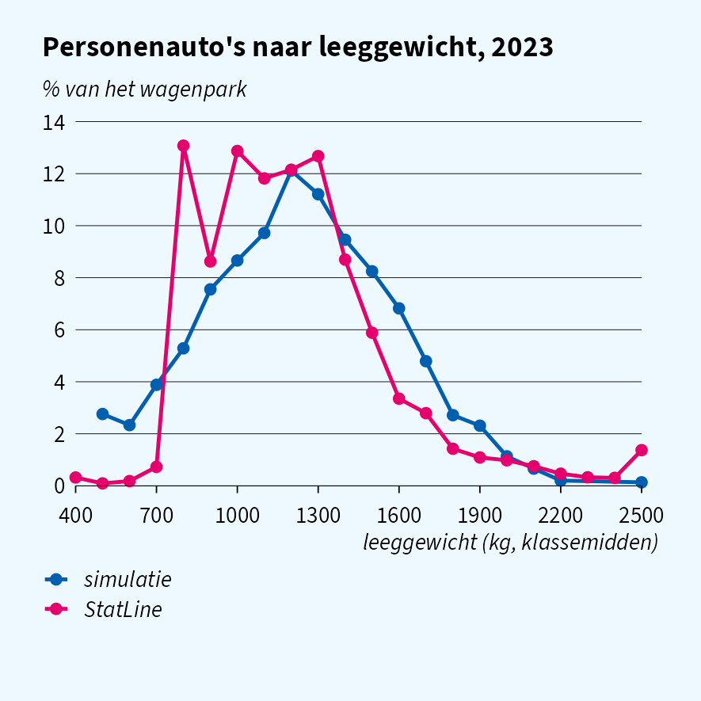
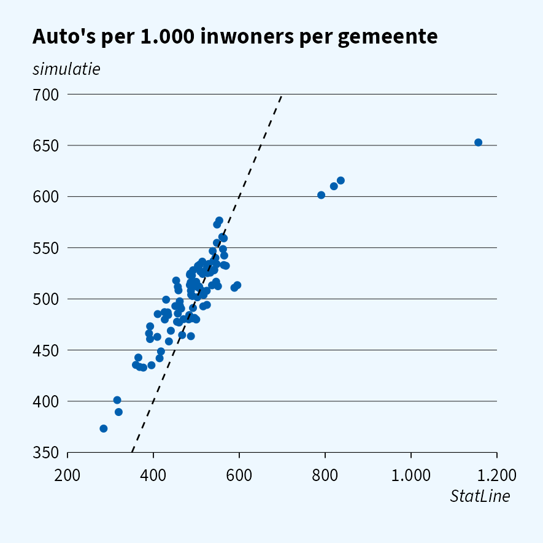
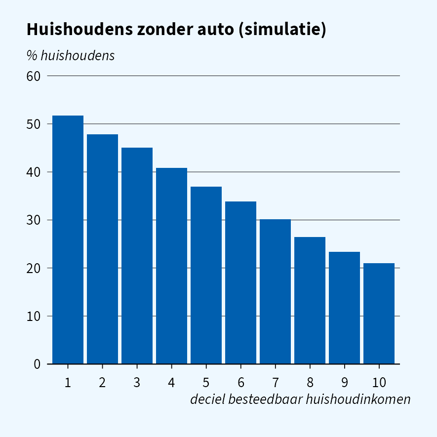

# Simulation quality: cars

> **How fast is the Dutch car fleet electrifying, and how does that
> differ by vehicle age, kilometres driven and region?**

This vignette runs that question on simulated RDW data (`RDWNPACT`,
`VERKEERSPRESTATIE`) linked to woonbase, and compares the answers with
the published CBS StatLine figures. Part of a series with
[`vignette("quality-income")`](https://joris-klingen.github.io/simregdata/articles/quality-income.md)
and
[`vignette("quality-energy")`](https://joris-klingen.github.io/simregdata/articles/quality-energy.md).

## At a glance

| Moment | Matches StatLine? | Safe for research? |
|----|----|----|
| Cars per inhabitant | yes | yes |
| Fuel mix per year | yes | yes |
| Age profile of the fleet | yes | yes |
| Average annual kilometres | yes | yes |
| Car density per gemeente | ranking yes, spread compressed | relative only |
| Weight distribution | mean and spread only | marginal only |
| EV share by construction year | no | no |
| Kilometres by fuel | no | no |
| Car ownership by income | no | no |

Marginals calibrated to StatLine are reproduced, so the headline (how
fast the fleet electrifies) can be developed on simulated data. Anything
that depends on the *joint* distribution of vehicle characteristics is
not: the simulator draws fuel, construction year, weight and mileage
independently.

## Simulated data

One woonbase population and RDW fleet per year, keeping passenger cars.

``` r

YEARS <- 2019:2025

simulate_year <- function(year) {
  sim_reset()
  woonbase_init(year = year, n = 20000L, seed = 42L)
  sim_init("rdw", year = year, seed = 43L)

  pers <- as.data.table(read_sav(sprintf("WoonbasePopulatiePersonen%dV1", year),
                                 col_select = c(RINPERSOON, GemeenteCodeJJJJ1Jan)))
  kent <- as.data.table(read_sav(sprintf("RDWNPACT%dTABV1", year),
    col_select = c(RINPERSOON, RINKENTEKEN, VRTGSOORT, BRANDSTCODECORVRTG,
                   EERSTETOELDAT1VRTG, MASSALEEGCORVRTG)))
  vp <- as.data.table(read_sav(sprintf("VERKEERSPRESTATIE%dTABV1", year),
                               col_select = c(RINKENTEKEN, VPJAARKM)))

  kent[vp, on = "RINKENTEKEN", jaarkm := as.numeric(i.VPJAARKM)]
  kent[, `:=`(year = year, n_pers = nrow(pers),
              bouwjaar = as.integer(EERSTETOELDAT1VRTG),
              gewicht = as.numeric(MASSALEEGCORVRTG),
              fuelcode = as.character(cbs_code(BRANDSTCODECORVRTG)))]
  kent[grepl("personenauto", as_factor(VRTGSOORT))]
}
cars <- rbindlist(lapply(YEARS, simulate_year))

# StatLine reports hybrids under petrol, so PHEV (A) and HEV (B) join petrol
cars[, brandstof := fcase(fuelcode %in% c("1", "A", "B"), "benzine",
                          fuelcode == "2", "diesel", fuelcode == "3", "lpg",
                          fuelcode == "4", "elektrisch", default = "overig")]
```

StatLine tables used: 85237NED (fuel, construction year, weight),
85236NED (vehicles by region), 85404NED (kilometres), 37230ned
(population).

## Fleet size and fuel mix

``` r

sim_fleet <- cars[year == 2023, .N / n_pers[1] * 1000]
```

|                                            | simulatie | StatLine |
|:-------------------------------------------|----------:|---------:|
| Passenger cars per 1,000 inhabitants, 2023 |       497 |      501 |

``` r

sim_fuel <- cars[, .N, by = .(year, brandstof)][
  , .(brandstof, aandeel = N / sum(N) * 100, bron = "simulatie"), by = year]
```



Both match up to sampling noise. Plug-in and regular hybrids are split
from petrol using fleet estimates, not a StatLine series, so questions
about hybrids specifically are less well grounded.

## Vehicle age

``` r

bin_bouwjaar <- function(y) {
  b <- pmin(2020L, pmax(2000L, y - y %% 5L))
  factor(fifelse(b == 2000L, "voor 2005",
                 fifelse(b == 2020L, "2020 en later", paste0(b, "-", b + 4L))),
         levels = c("voor 2005", "2005-2009", "2010-2014", "2015-2019", "2020 en later"))
}
cars23 <- cars[year == 2023, .(bouwjaargroep = bin_bouwjaar(bouwjaar), brandstof)]
sim_age <- cars23[, .(aandeel = .N / nrow(cars23) * 100,
                      aandeel_ev = mean(brandstof == "elektrisch") * 100,
                      bron = "simulatie"), by = bouwjaargroep]
```



The age profile matches, because construction years are drawn from
85237NED. The EV share by construction year does not: in reality nearly
all electric cars are recent, while the simulator gives every
construction year the same EV share. Code that cross-tabulates fuel by
vehicle age runs, but the result carries no information.

## Kilometres and weight

``` r

cars23 <- cars[year == 2023 & !is.na(jaarkm)]
cars23[, groep := fcase(brandstof == "diesel", "diesel", brandstof == "lpg", "lpg",
                        default = "benzine/overige")]
sim_km <- rbindlist(list(cars23[, .(groep = "totaal", km = mean(jaarkm))],
                         cars23[, .(km = mean(jaarkm)), by = groep]))[, bron := "simulatie"]
```



The fleet-wide mileage matches, but diesel cars are driven much further
than petrol cars in reality and equally far in the simulator: a
fuel-excise analysis gets the total right and the split wrong. Weight
has the right mean and spread, not the right shape, and does not differ
by fuel.

## Region

``` r

sim_reset()
woonbase_init(year = 2023, n = 200000L, seed = 42L)  # enough persons per gemeente
sim_init("rdw", year = 2023, seed = 43L)

pers <- as.data.table(read_sav("WoonbasePopulatiePersonen2023V1",
                               col_select = c(RINPERSOON, GemeenteCodeJJJJ1Jan)))
kent <- as.data.table(read_sav("RDWNPACT2023TABV1", col_select = c(RINPERSOON, VRTGSOORT)))
kent <- kent[grepl("personenauto", as_factor(VRTGSOORT))]
kent[pers, on = "RINPERSOON", gemeente := as.character(i.GemeenteCodeJJJJ1Jan)]

sim_gem <- pers[, .(inwoners = .N), by = .(gemeente = as.character(GemeenteCodeJJJJ1Jan))]
sim_gem[kent[, .N, by = gemeente], on = "gemeente", autos := i.N]
sim_gem[, sim := fcoalesce(autos, 0L) / inwoners * 1000]
```



The ranking of gemeenten is reproduced (correlation 0.86), but the
spread is compressed, and the outliers on the right, where lease
companies register their cars, are missing.

## Income

``` r

hh <- as.data.table(read_sav("WOONBASEEKHuishoudensWV2023V1",
                             col_select = c(RINPERSOON, P100HBEST1JAN)))
hh_nr <- as.data.table(read_sav("WoonbasePopulatieHuishoudens2023V1",
                                col_select = c(RINPERSOON, HUISHOUDNR1Jan)))
pers_hh <- as.data.table(read_sav("WoonbasePopulatiePersonen2023V1",
                                  col_select = c(RINPERSOON, HUISHOUDNR1Jan)))
hh[hh_nr, on = "RINPERSOON", HUISHOUDNR1Jan := i.HUISHOUDNR1Jan]
kent[pers_hh, on = "RINPERSOON", HUISHOUDNR1Jan := i.HUISHOUDNR1Jan]
hh[, `:=`(heeft_auto = HUISHOUDNR1Jan %in% kent$HUISHOUDNR1Jan,
          deciel = factor(pmin(10L, ceiling(as.numeric(P100HBEST1JAN) / 10)), levels = 1:10))]
```



Car owners are drawn regardless of income, so the share of households
without a car is flat across income deciles, while in reality it falls
steeply with income. Combine RDW with income only to test code.
