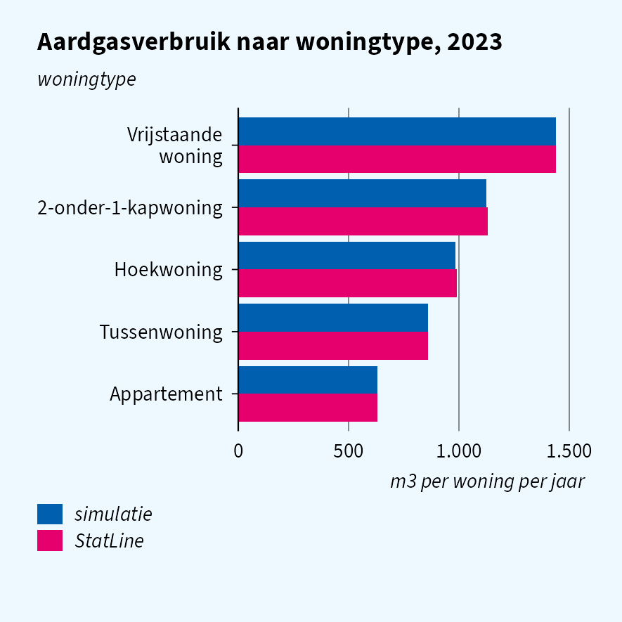
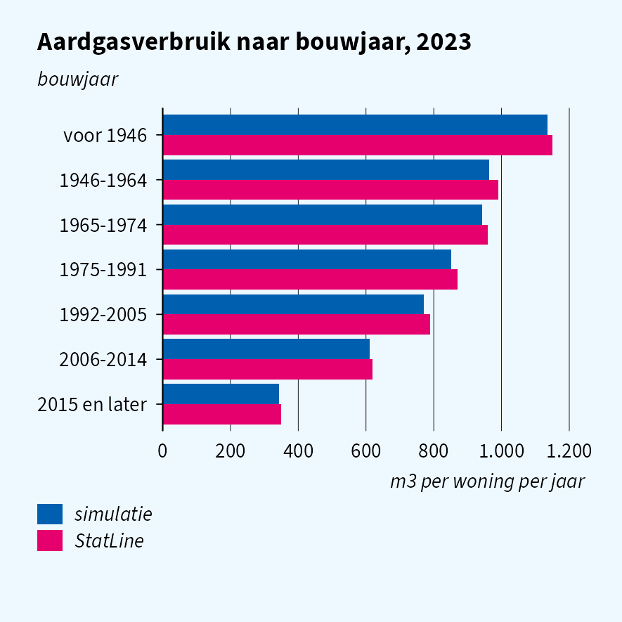
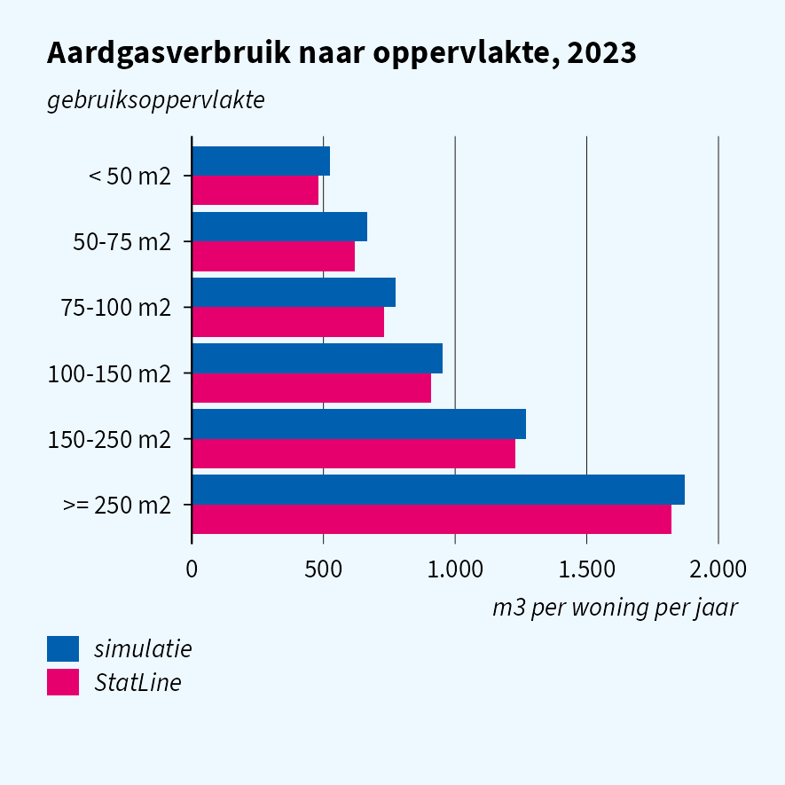
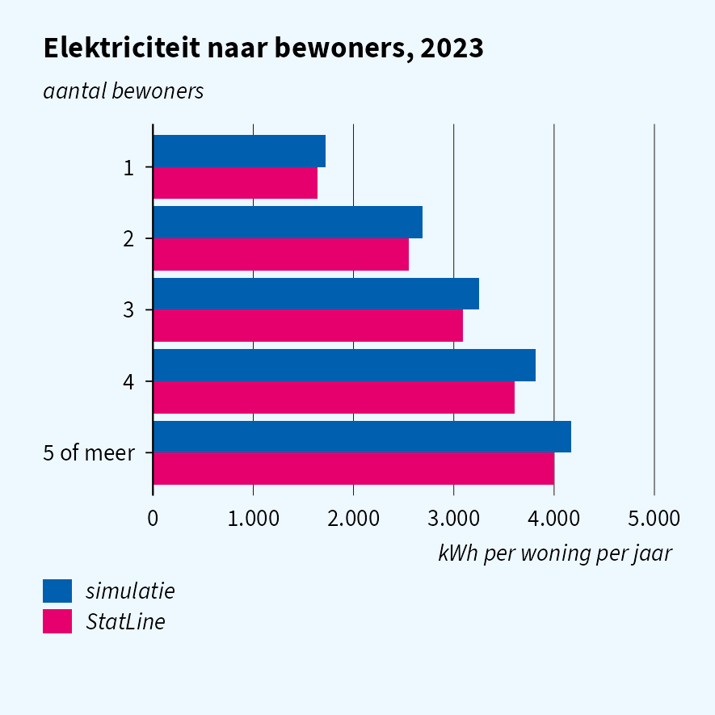
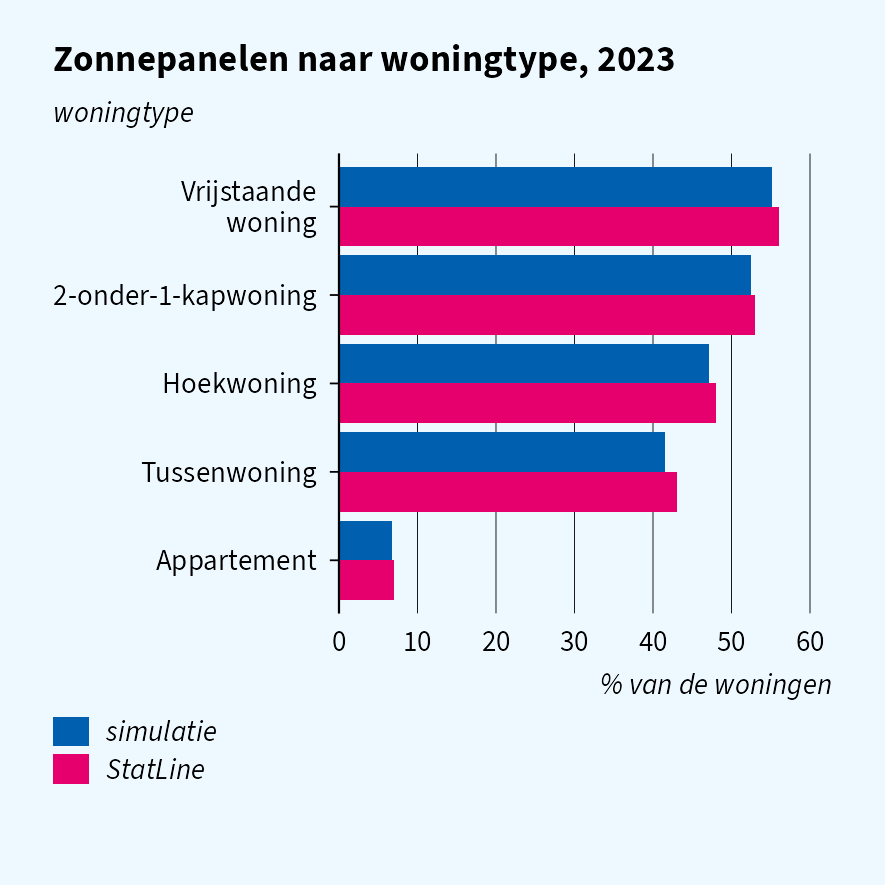
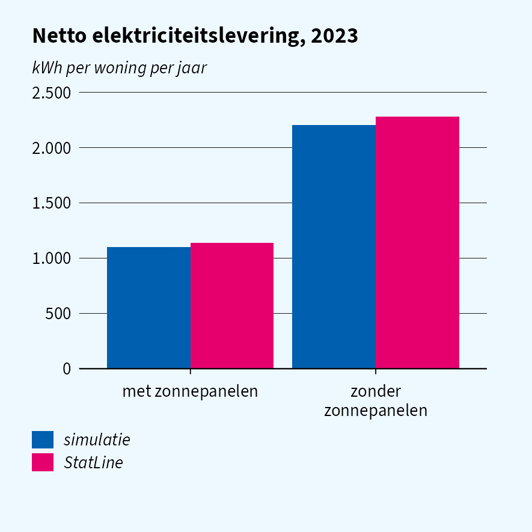
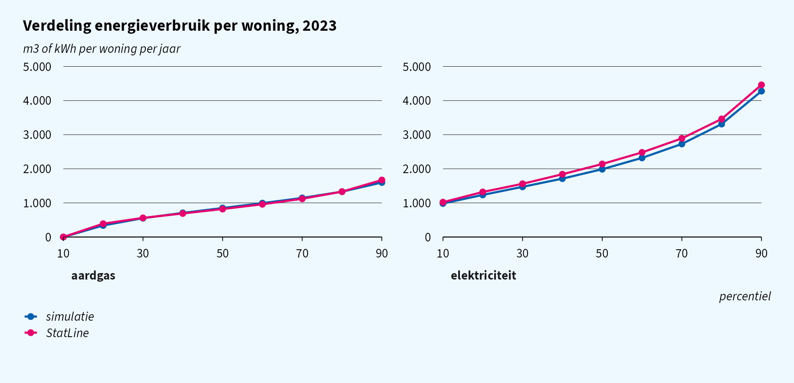

# Simulation quality: energy use of dwellings

> **Which dwellings use the most gas and electricity, and how much do
> solar panels reduce the net electricity demand of a household?**

This vignette runs that question on simulated `ENERGIEVERBRUIK` linked
to the woonbase dwellings, and compares the answers with StatLine
85140NED (energy use by dwelling type, construction year, floor area,
occupants and solar panels) and 81528NED (national averages). Part of a
series with
[`vignette("quality-cars")`](https://joris-klingen.github.io/simregdata/articles/quality-cars.md)
and
[`vignette("quality-income")`](https://joris-klingen.github.io/simregdata/articles/quality-income.md).

## At a glance

| Moment | Matches StatLine? | Safe for research? |
|----|----|----|
| Gas by dwelling type, construction year, floor area | yes, within a few percent | yes |
| Electricity by number of occupants | gradient yes, about 5% high | yes |
| Solar panels by dwelling type | yes | yes |
| Net electricity with and without panels | yes | yes |
| Percentiles of gas and electricity | yes | yes |
| National means per year | trend yes, a few percent low | yes |
| Interactions not in the one-way tables | not calibrated | no |

Gas and electricity are generated per dwelling from its characteristics
and fitted to the one-way means and percentiles of 85140NED. National
averages are a few percent low because the simulated stock has more
small dwellings and single-person households than the real one.

## Simulated data

``` r

sim_reset()
woonbase_init(year = 2023, n = 50000L, seed = 42L)
sim_init("energieverbruik", year = 2023, seed = 43L)

energie <- as.data.table(read_sav("ENERGIEVERBRUIK2023TABV1",
  col_select = c(RINOBJECTNUMMER, GASSJV, ELEK, ELEKTERUG, ELEKNETTO, ZONPV)))
woonr <- as.data.table(read_sav("WoonbasePopulatieWoonruimten2023V1",
  col_select = c(RINOBJECTNUMMER, VBOWoningType1Jan, AantalPersonenPerVSLKlasse1Jan)))
kenm <- as.data.table(read_sav("WoonbaseKenmerkenWoonruimten2023V1",
  col_select = c(RINOBJECTNUMMER, VBOBouwjaar1Jan, VBOOppervlakte1Jan)))

# GASSJV is temperature corrected, as in 85140NED
energie[, `:=`(gas = as.numeric(GASSJV), elek = as.numeric(ELEK),
               terug = as.numeric(ELEKTERUG), netto = as.numeric(ELEKNETTO),
               zon = cbs_code(ZONPV) == "1")]
energie[woonr, on = "RINOBJECTNUMMER", `:=`(
  woningtype = as.character(as_factor(i.VBOWoningType1Jan)),
  bewoners   = as.character(as_factor(i.AantalPersonenPerVSLKlasse1Jan)))]
energie[kenm, on = "RINOBJECTNUMMER", `:=`(
  bouwjaar = as.integer(i.VBOBouwjaar1Jan), oppervlak = as.numeric(i.VBOOppervlakte1Jan))]
```

The dwelling characteristics in the classes of 85140NED:

``` r

BJ  <- c("voor 1946" = 1000, "1946-1964" = 1946, "1965-1974" = 1965, "1975-1991" = 1975,
         "1992-2005" = 1992, "2006-2014" = 2006, "2015 en later" = 2015)
OPP <- c("< 50 m2" = 2, "50-75 m2" = 50, "75-100 m2" = 75, "100-150 m2" = 100,
         "150-250 m2" = 150, ">= 250 m2" = 250)
energie[, `:=`(
  woningtype  = fcase(woningtype == "Vrijstaande woning", "Vrijstaande woning",
                      woningtype == "Twee-onder-een-kapwoning", "2-onder-1-kapwoning",
                      woningtype == "Hoekwoning", "Hoekwoning",
                      woningtype == "Tussenwoning", "Tussenwoning",
                      woningtype == "Meergezinswoning", "Appartement"),
  bouwjaar    = names(BJ)[findInterval(bouwjaar, BJ)],
  oppervlakte = names(OPP)[findInterval(oppervlak, OPP)],
  bewoners    = fifelse(bewoners %in% c("5", "6-9", ">=10"), "5 of meer", bewoners))]

by_kenmerk <- function(k) {
  energie[!is.na(get(k)), .(gas = mean(gas), elek = mean(elek), zon = mean(zon) * 100),
          by = .(klasse = get(k))][, kenmerk := k]
}
sim_by <- rbindlist(lapply(c("woningtype", "bouwjaar", "oppervlakte", "bewoners"), by_kenmerk))
```

## Gas by dwelling



The gradients are reproduced: a detached house uses more than twice the
gas of an apartment, the largest dwellings nearly four times the
smallest, and gas use falls steadily with the construction year.

## Electricity and solar panels

``` r

energie[, .(netto = mean(netto), teruglevering = mean(terug)), by = .(zonnepanelen = zon)]
#>    zonnepanelen    netto teruglevering
#>          <lgcl>    <num>         <num>
#> 1:        FALSE 2203.572          0.00
#> 2:         TRUE 1102.415       1750.33
```



Electricity rises with the number of occupants, a few percent high in
every group. Solar panels follow the published shares per dwelling type,
and net electricity of dwellings with panels is half that of dwellings
without, as published. Feed-in exists only with panels, and `ELEKNETTO`
equals `ELEK - ELEKTERUG`.

## Distribution and trend

``` r

sim_pct <- energie[, .(percentiel = seq(10, 90, 10),
                       aardgas = quantile(gas, seq(0.1, 0.9, 0.1)),
                       elektriciteit = quantile(elek, seq(0.1, 0.9, 0.1)))]
```



Both distributions follow the published percentiles, including the tenth
of dwellings without gas (district heating, most new dwellings, other
all-electric homes). The national means follow the published trend a few
percent low: the model matches the mean *within* each dwelling group,
and the simulated stock has relatively more small, low-use dwellings.
