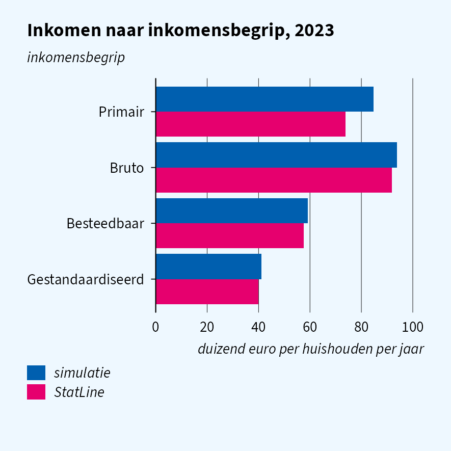
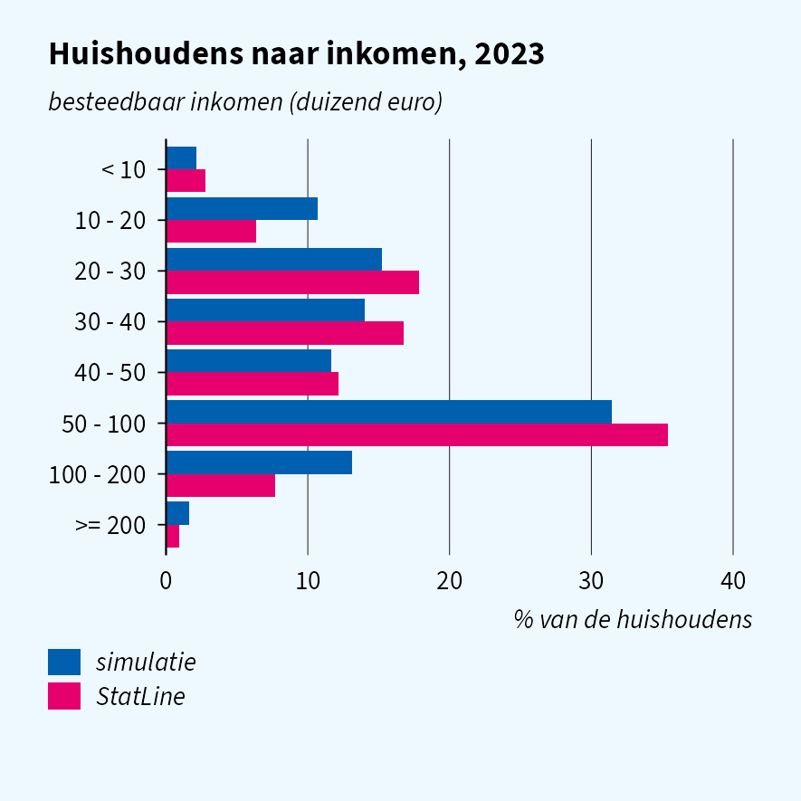
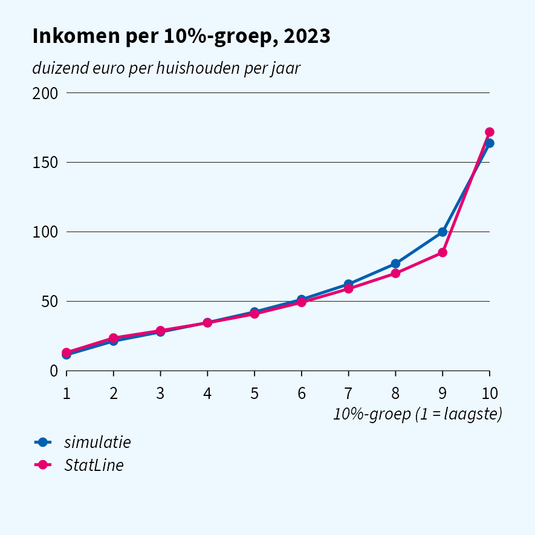
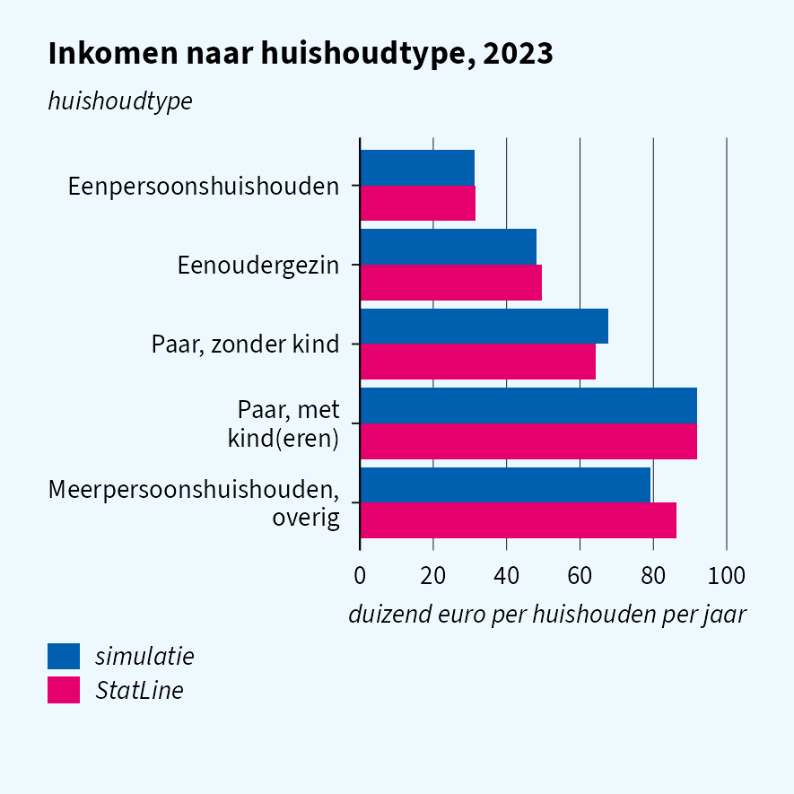

# Developing a household income analysis

> **How unequal is household disposable income in the Netherlands, and
> how does it differ between household types?**

The analysis itself will run in CBS Remote Access. This page develops
its code on simulated `INHATAB` (household income) linked to woonbase
household types, and uses StatLine 83932NED, the published aggregate of
the same register, to show which simulated results look like the real
ones. Similar pages:
[`vignette("quality-cars")`](https://joris-klingen.github.io/simregdata/articles/quality-cars.md)
and
[`vignette("quality-energy")`](https://joris-klingen.github.io/simregdata/articles/quality-energy.md).

## At a glance

| Result | Looks like reality? | In Remote Access |
|----|----|----|
| Mean and median income, overall and by household type | yes | similar; a large gap means a bug |
| Gross and standardised income | yes | similar |
| Percentile columns, including special codes | yes | similar |
| Distribution over income classes | too wide | more concentrated in the middle |
| Decile means (inequality) | deciles 1 to 7 | lower in deciles 8 and 9 |
| Primary income | too high | lower |
| Personal incomes summing to household income | no | consistent |

Household income is drawn per household type from the mean and median of
83932NED; the class distribution and decile means are not calibrated.

## Simulated data

``` r

sim_reset()
woonbase_init(year = 2023, n = 50000L, seed = 42L)
sim_init("inhatab", year = 2023, seed = 43L)
sim_init("inpatab", year = 2023, seed = 44L)

pers <- as.data.table(read_sav("WoonbasePopulatiePersonen2023V1",
                               col_select = c(RINPERSOON, HUISHOUDNR1Jan)))
hh <- as.data.table(read_sav("WoonbasePopulatieHuishoudens2023V1",
                             col_select = c(HUISHOUDNR1Jan, TYPHH1Jan)))
inpa <- as.data.table(read_sav("INPA2023TABV1",
                               col_select = c(RINPERSOON, RINPERSOONHKW, INPPERSBESTINK)))
inha <- as.data.table(read_sav("INHA2023TABV1"))
# percentile codes -1 (unknown income, money fields 9999999999) and
# -2 (institutional household) are outside the StatLine population
inha <- inha[INHP100HBEST > 0]

# INHATAB is keyed on RINPERSOONHKW; INPATAB links it to persons, woonbase
# links persons to households
inpa[pers, on = "RINPERSOON", HUISHOUDNR1Jan := i.HUISHOUDNR1Jan]
inha[unique(inpa, by = "RINPERSOONHKW"), on = "RINPERSOONHKW",
     HUISHOUDNR1Jan := i.HUISHOUDNR1Jan]
hh[inha, on = "HUISHOUDNR1Jan", `:=`(
  inkomen = as.numeric(i.INHBESTINKH), p100 = as.numeric(i.INHP100HBEST),
  primair = as.numeric(i.INHPRIMINKH), bruto = as.numeric(i.INHBRUTINKH),
  gestand = as.numeric(i.INHGESTINKH))]

# StatLine covers private households only
hh <- hh[!is.na(inkomen) & as_factor(TYPHH1Jan) != "Institutioneel huishouden"]
```

## Level and income concepts

``` r

sim_level <- hh[, .(gemiddeld = mean(inkomen), mediaan = median(inkomen))]
```

|                          | simulatie | StatLine |
|:-------------------------|----------:|---------:|
| Mean disposable income   |    59,200 |   57,600 |
| Median disposable income |    46,700 |   44,700 |



Gross and standardised income follow disposable income closely. Primary
income comes out too high: it is far more skewed (pensioners have little
of it) than a single ratio per household type can capture.

## Distribution and inequality

``` r

sim_dec <- hh[order(inkomen), .(deciel = ceiling(seq_len(.N) / .N * 10), inkomen)][
  , .(gemiddeld = mean(inkomen), bron = "simulatie"), by = deciel]
```



The simulated distribution is wider than the real one: too many
households between 10 and 20 thousand euro and between 100 and 200
thousand, too few in the middle. The top decile averages 164 thousand
euro against 172 thousand in reality. Code for classes and deciles runs
unchanged; expect a more concentrated distribution in Remote Access.

`INHP100HBEST` is the rank of the household income (rank correlation
1.000), so grouping on it gives the same deciles as computing the ranks
yourself.

## Household type

``` r

hh[, type := fcase(
  TYPHH1Jan %in% 1,   "Eenpersoonshuishouden",
  TYPHH1Jan %in% 6,   "Eenoudergezin",
  TYPHH1Jan %in% 2:3, "Paar, zonder kind",
  TYPHH1Jan %in% 4:5, "Paar, met kind(eren)",
  TYPHH1Jan %in% 7,   "Meerpersoonshuishouden, overig")]
sim_type <- hh[!is.na(type), .(gemiddeld = mean(inkomen), bron = "simulatie"), by = type]
```



Couples with children have about three times the income of single-person
households, in the simulation as in reality.

## Persons and households

``` r

pers_sum <- inpa[, .(som_personen = sum(as.numeric(INPPERSBESTINK))), by = RINPERSOONHKW]
pers_sum[inha, on = "RINPERSOONHKW", huishouden := as.numeric(i.INHBESTINKH)]
pers_sum[, cor(som_personen, huishouden, use = "complete.obs")]
#> [1] 0.2755623
```

Personal incomes in `INPATAB` are drawn independently of the household,
so they do not add up to the household income. Code that splits
household income over its members runs, but a consistency check like the
one above only passes on the real data.

## Before you move to Remote Access

The simulated `INHATAB` has the special values of the real file: unknown
incomes (9999999999 in money fields, -1 in percentiles), institutional
households (-2) and negative incomes. The filter on `INHP100HBEST` above
removes the first two; without it the mean income is off by orders of
magnitude. Negative incomes stay in, as in StatLine, so
[`log()`](https://rdrr.io/r/base/Log.html) or ratios to income need a
rule for them.

What still differs is content: the spread of the distribution, primary
income and the link between personal and household income.
