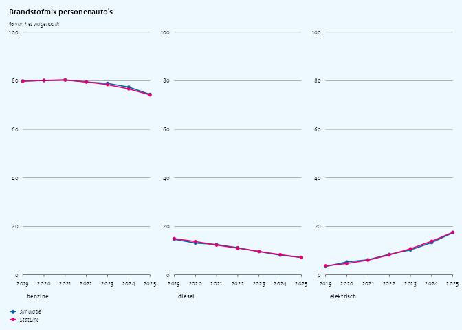
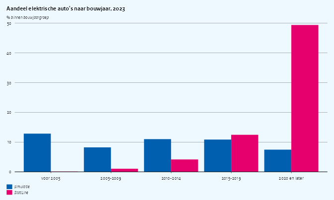
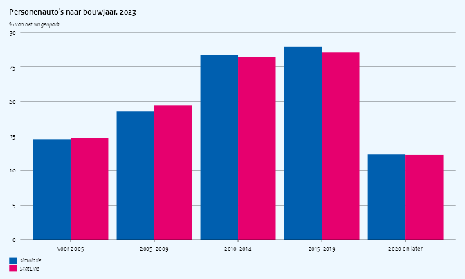
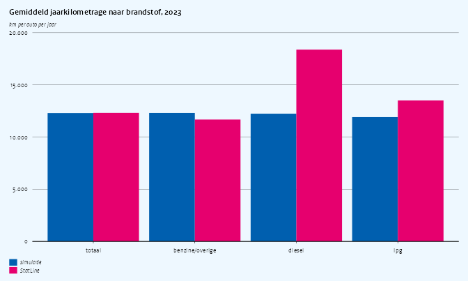
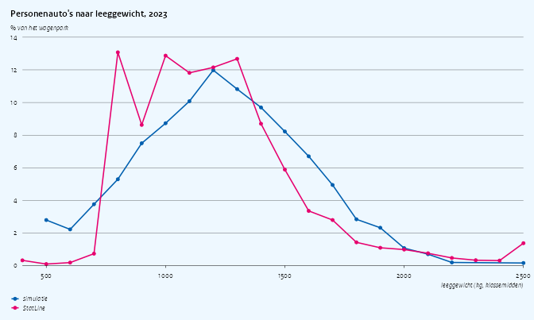
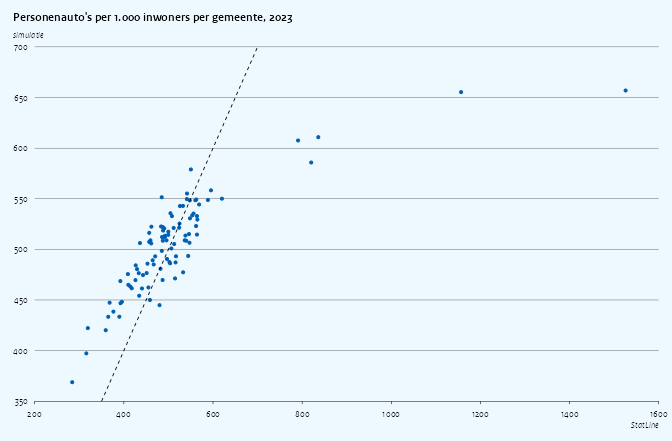
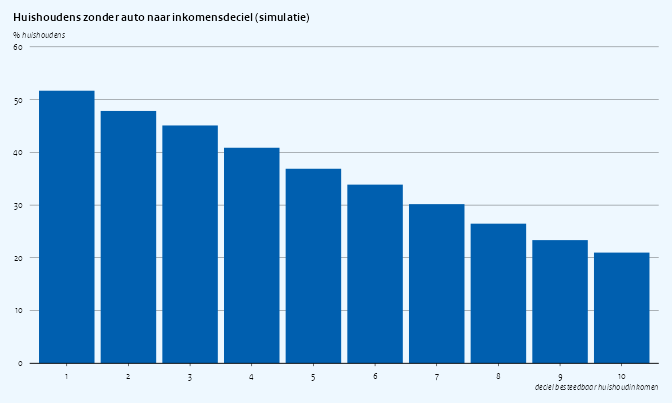

Simulation quality: cars
================

This is the first of a series of vignettes that ask: *if I develop an
analysis on simregdata, how close will the answers be to what I get on
the real CBS microdata?* Each vignette takes one research question, runs
it on simulated data, and puts the outcome next to the published CBS
StatLine figures that the real microdata aggregate to.

The research question here:

> **How fast is the Dutch passenger-car fleet electrifying, and how does
> that differ by vehicle age, kilometres driven and region?**

It needs the RDW files `RDWNPACT{YYYY}TABV1` (vehicles) and
`VERKEERSPRESTATIE{YYYY}TABV1` (annual kilometres), linked to the
woonbase population for the region and household.

The short version: the fuel mix per year, the headline of the question,
is reproduced, as are the other marginals calibrated to StatLine (cars
per inhabitant, the age profile of the fleet, average mileage, the
ranking of gemeenten by car density). Anything that depends on the
*joint* distribution of vehicle characteristics (EVs among new cars,
mileage by fuel, weight by fuel) is not reproduced, because the
simulator draws those columns independently. The sections below show
where the line falls.

## Setup

``` r
library(data.table)
library(haven)
library(ggplot2)
library(ggcpb)
library(simregdata)  # after haven, so read_sav() is the simulator's
```

`statline()` fetches a StatLine table with the dimension labels added,
retrying a few times on a dropped connection, and returns `NULL` when
StatLine cannot be reached (dimension codes are trimmed and the
`*_label` columns are plain character); the comparison plots then show
the simulated series only.

``` r
options(cbsodataR.base_url = "https://opendata.cbs.nl")

statline <- function(id, ..., tries = 3L) {
  for (i in seq_len(tries)) {
    dt <- tryCatch(
      suppressWarnings(as.data.table(cbsodataR::cbs_add_label_columns(
        cbsodataR::cbs_get_data(id, ...)))),
      error = function(e) {
        tcat("StatLine table ", id, " attempt ", i, " failed: ", conditionMessage(e))
        NULL
      })
    if (!is.null(dt)) break
  }
  if (is.null(dt)) return(NULL)
  for (j in names(dt)) {
    if (is.factor(dt[[j]]) || is.character(dt[[j]])) {
      set(dt, j = j, value = trimws(as.character(dt[[j]])))
    }
  }
  dt
}

# first measure column whose name matches `pattern`
measure <- function(dt, pattern) {
  col <- grep(pattern, names(dt), value = TRUE)[1]
  if (is.na(col)) stop("no column matching ", pattern)
  as.numeric(dt[[col]])
}

period <- function(year) paste0(year, "JJ00")
```

### Simulated data

We simulate one woonbase population per year and read the vehicle files.
`n = 20000` persons per year keeps the vignette fast; the sampling noise
this leaves is visible in the plots and shrinks with larger `n`.

Years without stored woonbase parameters fall back to the nearest year
with a warning; those warnings are suppressed here.

``` r
YEARS  <- 2019:2025
N_PERS <- 20000L

simulate_year <- function(year) {
  sim_reset()
  woonbase_init(year = year, n = N_PERS, seed = 42L)
  sim_init("rdw", year = year, seed = 43L)

  pers <- as.data.table(read_sav(
    sprintf("WoonbasePopulatiePersonen%dV1", year),
    col_select = c(RINPERSOON, GemeenteCodeJJJJ1Jan)
  ))
  kent <- as.data.table(read_sav(
    sprintf("RDWNPACT%dTABV1", year),
    col_select = c(RINPERSOON, RINKENTEKEN, VRTGSOORT, BRANDSTCODECORVRTG,
                   EERSTETOELDAT1VRTG, MASSALEEGCORVRTG)
  ))
  vp <- as.data.table(read_sav(
    sprintf("VERKEERSPRESTATIE%dTABV1", year),
    col_select = c(RINKENTEKEN, VPJAARKM)
  ))

  kent[, `:=`(
    year     = year,
    soort    = as.character(as_factor(VRTGSOORT)),
    fuelcode = as.character(cbs_code(BRANDSTCODECORVRTG)),
    bouwjaar = as.integer(EERSTETOELDAT1VRTG),
    gewicht  = as.numeric(MASSALEEGCORVRTG)
  )]
  kent[vp, on = "RINKENTEKEN", jaarkm := as.numeric(i.VPJAARKM)]
  kent[pers, on = "RINPERSOON", gemeente := as.character(i.GemeenteCodeJJJJ1Jan)]

  list(n_pers = nrow(pers), pers = pers[, .(gemeente = as.character(GemeenteCodeJJJJ1Jan))],
       cars = kent[grepl("personenauto", soort)])
}

sims <- lapply(YEARS, function(y) {
  tcat("simulating ", y)
  simulate_year(y)
})
#> [2026-10-23 09:33:15] simulating 2019
#> [2026-10-23 09:33:17] simulating 2020
#> [2026-10-23 09:33:18] simulating 2021
#> [2026-10-23 09:33:19] simulating 2022
#> [2026-10-23 09:33:20] simulating 2023
#> [2026-10-23 09:33:21] simulating 2024
#> [2026-10-23 09:33:22] simulating 2025
names(sims) <- YEARS

cars <- rbindlist(lapply(sims, `[[`, "cars"))

# StatLine 85237NED reports hybrids under their primary fuel; collapse the
# simulator's PHEV (A) and HEV (B) codes into petrol to match
cars[, brandstof := fcase(
  fuelcode %in% c("1", "A", "B"), "benzine",
  fuelcode == "2",                "diesel",
  fuelcode == "3",                "lpg",
  fuelcode == "4",                "elektrisch",
  default =                       "overig"
)]
FUELS <- c("benzine", "diesel", "lpg", "elektrisch", "overig")
cars[, brandstof := factor(brandstof, levels = FUELS)]
```

### StatLine reference tables

| Table    | Content                                                 | Used for                     |
|----------|---------------------------------------------------------|------------------------------|
| 85237NED | Passenger cars by construction year: fuel, weight class | fuel mix, EVs by age, weight |
| 85236NED | Vehicles by type and region                             | fleet size, regional density |
| 85404NED | Mileage of passenger cars by fuel, age and ownership    | kilometres                   |
| 37230ned | Population by region                                    | cars per 1,000 inhabitants   |

``` r
sl_237 <- rbindlist(lapply(YEARS, function(y) {
  dt <- statline("85237NED", Perioden = period(y))
  if (!is.null(dt)) dt[, year := y]
  dt
}))
sl_236 <- statline("85236NED", Perioden = period(2023))
sl_404 <- statline("85404NED", Perioden = period(2023))
sl_pop <- statline("37230ned", Perioden = period(2023))

has_statline <- nrow(sl_237) > 0 && !is.null(sl_236) &&
  !is.null(sl_404) && !is.null(sl_pop)
tcat("StatLine reachable: ", has_statline)
#> [2026-10-23 09:33:48] StatLine reachable: TRUE
```

## Fleet size

The number of passenger cars per 1,000 inhabitants is the denominator of
every share below. The simulator draws the RDW fleet size and
vehicle-type mix from 85236NED, so this should match up to sampling
noise.

``` r
sim_density <- cars[year == 2023, .(bron = "simulatie",
  auto_per_1000 = .N / sims[["2023"]]$n_pers * 1000)]

sl_density <- if (has_statline) {
  n_cars <- measure(sl_236[RegioS == "NL01"], "^Personenauto")
  n_pop  <- measure(sl_pop[RegioS == "NL01"], "^BevolkingAanHetBegin")
  data.table(bron = "StatLine", auto_per_1000 = n_cars / n_pop * 1000)
}
rbindlist(list(sim_density, sl_density))
#>         bron auto_per_1000
#> 1: simulatie      496.8224
#> 2:  StatLine      500.6435
```

Every simulated car has an owner in that year’s woonbase population, so
an inner join of RDW on `WoonbasePopulatiePersonen` keeps the whole
fleet:

``` r
cars[year == 2023, .(autos = .N,
                     eigenaar_niet_in_populatie = mean(is.na(gemeente)) * 100)]
#>    autos eigenaar_niet_in_populatie
#> 1:  8912                          0
```

## Fuel mix over time

The core of the research question. Fuel shares per year are taken
directly from 85237NED, so the simulated trend should follow StatLine.

``` r
sim_fuel <- cars[, .N, by = .(year, brandstof)][
  , .(brandstof, aandeel = N / sum(N) * 100, bron = "simulatie"), by = year]

sl_fuel <- if (has_statline) {
  tot <- sl_237[grepl("^T", Bouwjaar)][, .SD[1], by = year]
  tot <- tot[, .(year,
    benzine    = measure(.SD, "^Benzine"),
    diesel     = measure(.SD, "^Diesel"),
    lpg        = measure(.SD, "^LPG"),
    elektrisch = measure(.SD, "^Elektriciteit"),
    overig     = measure(.SD, "^CNG") + measure(.SD, "^OverigOnbekend")),
    by = year][, year := NULL]
  tot <- melt(tot, id.vars = "year", variable.name = "brandstof", value.name = "n")
  tot[, .(brandstof, aandeel = n / sum(n) * 100, bron = "StatLine"), by = year]
}
fuel <- rbindlist(list(sim_fuel, sl_fuel), use.names = TRUE)
fuel[, brandstof := factor(brandstof, levels = FUELS)]

# LPG and other fuels stay below 2% and are left out of the figure
cpb_line(fuel[brandstof %in% c("benzine", "diesel", "elektrisch")],
  x = year, y = aandeel, colour = bron,
  points     = TRUE,
  facet      = brandstof,
  facet_ncol = 3,
  title = "Brandstofmix personenauto's",
  ylab  = "% van het wagenpark")
```



``` r
dcast(fuel[brandstof == "elektrisch"], year ~ bron, value.var = "aandeel")
#>    year  StatLine simulatie
#> 1: 2019  3.722749  3.427419
#> 2: 2020  4.681951  5.334570
#> 3: 2021  6.056834  6.229848
#> 4: 2022  8.212618  8.466742
#> 5: 2023 10.742116 10.267056
#> 6: 2024 13.835399 13.280729
#> 7: 2025 17.529999 17.330591
```

The simulated shares sit on the StatLine trend for every fuel; what is
left is sampling noise from ~10,000 simulated cars per year. One caveat
for a finer split: the simulator separates plug-in (PHEV) and regular
hybrids (HEV) from petrol using fleet *estimates*, not a StatLine
series, so a question about hybrids specifically is less well grounded
than one about battery-electric cars.

## Electric cars by construction year

A natural follow-up: *are EVs concentrated among young cars?* In the
real fleet almost all battery-electric cars were built in the last
decade. In the simulator the fuel type and construction year are drawn
independently, so the EV share is the same in every construction-year
group.

``` r
# both sides binned into five-year groups, with open groups at both ends
bin_bouwjaar <- function(y) {
  b <- pmin(2020L, pmax(2000L, y - y %% 5L))
  factor(fifelse(b == 2000L, "voor 2005",
         fifelse(b == 2020L, "2020 en later", paste0(b, "-", b + 4L))),
         levels = c("voor 2005", "2005-2009", "2010-2014", "2015-2019", "2020 en later"))
}

sim_ev <- cars[year == 2023, .(aandeel_ev = mean(brandstof == "elektrisch") * 100,
                               bron = "simulatie"),
               by = .(bouwjaargroep = bin_bouwjaar(bouwjaar))]

sl_ev <- if (has_statline) {
  # the Bouwjaar dimension holds both decade groups and single years; keep
  # the single years only, so no car is counted twice
  bj <- sl_237[year == 2023 & grepl("^Bouwjaar \\d{4}$", Bouwjaar_label)]
  bj[, jaar := as.integer(sub("Bouwjaar ", "", Bouwjaar_label))]
  bj[, `:=`(
    elek   = measure(.SD, "^Elektriciteit"),
    totaal = measure(.SD, "^Benzine") + measure(.SD, "^Diesel") +
             measure(.SD, "^LPG") + measure(.SD, "^Elektriciteit") +
             measure(.SD, "^CNG") + measure(.SD, "^OverigOnbekend")
  )]
  bj[, .(aandeel_ev = sum(elek, na.rm = TRUE) / sum(totaal, na.rm = TRUE) * 100,
         bron = "StatLine"),
     by = .(bouwjaargroep = bin_bouwjaar(jaar))]
}
ev <- rbindlist(list(sim_ev, sl_ev), use.names = TRUE)

cpb_col(ev, x = bouwjaargroep, y = aandeel_ev, fill = bron,
  position       = "dodge",
  reverse_legend = FALSE,
  title = "Aandeel elektrische auto's naar bouwjaar, 2023",
  ylab  = "% binnen bouwjaargroep")
```



The age profile of the fleet itself does match: `EERSTETOELDAT1VRTG` is
drawn from the single-year construction-year distribution of 85237NED
for the simulation year (for years before 2019, the first year in
85237NED, it is the 2019 distribution restricted to earlier construction
years).

``` r
sim_age <- cars[year == 2023, .N, by = .(bouwjaargroep = bin_bouwjaar(bouwjaar))][
  , .(bouwjaargroep, aandeel = N / sum(N) * 100, bron = "simulatie")]

sl_age <- if (has_statline) {
  bj[, .(n = sum(totaal, na.rm = TRUE)), by = .(bouwjaargroep = bin_bouwjaar(jaar))][
    , .(bouwjaargroep, aandeel = n / sum(n) * 100, bron = "StatLine")]
}
age <- rbindlist(list(sim_age, sl_age), use.names = TRUE)

cpb_col(age, x = bouwjaargroep, y = aandeel, fill = bron,
  position       = "dodge",
  reverse_legend = FALSE,
  title = "Personenauto's naar bouwjaar, 2023",
  ylab  = "% van het wagenpark")
```



**Verdict:** the age profile on its own can be used, but nothing
conditional on vehicle age (EV uptake among new cars, fuel or weight by
age). Code that computes such tables will *run*, but the cross-tabulated
numbers carry no information.

## Kilometres driven by fuel

For fuel-excise or emission questions the mileage per fuel type matters:
diesel cars are driven much further than petrol cars. The simulator
draws `VPJAARKM` from one normal distribution calibrated to the
fleet-wide mean of 85404NED, regardless of fuel. 85404NED splits mileage
into petrol (including electric and other fuels), diesel and LPG, so the
simulated cars are grouped the same way.

``` r
KM_FUELS <- c("totaal", "benzine/overige", "diesel", "lpg")

km_sim <- cars[year == 2023 & !is.na(jaarkm)]
km_sim[, groep := fcase(brandstof == "diesel", "diesel",
                        brandstof == "lpg",    "lpg",
                        default =              "benzine/overige")]
sim_km <- rbindlist(list(
  km_sim[, .(groep = "totaal", km = mean(jaarkm))],
  km_sim[, .(km = mean(jaarkm)), by = groep]
), use.names = TRUE)[, bron := "simulatie"]

sl_km <- if (has_statline) {
  km <- sl_404[grepl("^Totaal", LeeftijdVoertuig_label) &
               grepl("^Totaal", Eigendomssituatie_label)]
  km[, .(groep = tolower(Brandstofsoort_label),
         km    = measure(.SD, "^TotaalGemiddeldJaarkilometrage"),
         bron  = "StatLine")]
}
km_fuel <- rbindlist(list(sim_km, sl_km), use.names = TRUE)
km_fuel[, groep := factor(groep, levels = KM_FUELS)]

cpb_col(km_fuel[!is.na(groep)], x = groep, y = km, fill = bron,
  position       = "dodge",
  reverse_legend = FALSE,
  title = "Gemiddeld jaarkilometrage naar brandstof, 2023",
  ylab  = "km per auto per jaar")
```



The fleet-wide average matches; the split by fuel does not. A policy
simulation of fuel excise on these data will get the *total* about right
but put too much of the burden on petrol and too little on diesel.

## Vehicle weight

Weight drives the motor-vehicle tax (`mrb`). The simulator uses a normal
distribution with the mean and standard deviation of the 85237NED weight
classes.

``` r
WT_BREAKS <- c(-Inf, seq(450, 2450, by = 100), Inf)
wt_mid    <- c(400, seq(500, 2400, by = 100), 2500)

sim_wt <- cars[year == 2023, .N,
               by = .(klasse = cut(gewicht, WT_BREAKS, labels = FALSE))][
  , .(gewicht = wt_mid[klasse], aandeel = N / sum(N) * 100, bron = "simulatie")]

sl_wt <- if (has_statline) {
  tot23  <- sl_237[year == 2023 & grepl("^T", Bouwjaar)][1]
  wcols  <- grep("^k_\\d+Kg", names(tot23), value = TRUE)
  if (length(wcols) == length(wt_mid)) {
    n <- as.numeric(unlist(tot23[, ..wcols]))
    data.table(gewicht = wt_mid, aandeel = n / sum(n, na.rm = TRUE) * 100,
               bron = "StatLine")
  }
}
wt <- rbindlist(list(sim_wt, sl_wt), use.names = TRUE)

cpb_line(wt, x = gewicht, y = aandeel, colour = bron,
  points = TRUE,
  title = "Personenauto's naar leeggewicht, 2023",
  ylab  = "% van het wagenpark",
  xlab  = "leeggewicht (kg, klassemidden)")
```



The mean and spread line up, the shape does not: the real fleet has a
large block of light cars between 750 and 1,350 kg, which the normal
distribution spreads out into too many cars above 1,400 kg, and the
lower bound of 500 kg piles up a spurious class of very light cars.
Because weight is drawn independently of fuel, simulated electric cars
are not heavier than petrol cars, which they are in reality; a
weight-based tax analysis by fuel type inherits that.

## Regional car density

The simulator samples vehicle owners with gemeente weights computed from
85236NED (cars per gemeente) and 37230ned (population per gemeente), so
car density per gemeente should be reproduced. With 20,000 persons
spread over 342 gemeenten each gemeente only has a few dozen simulated
persons, so we simulate a larger population for this check.

``` r
sim_reset()
woonbase_init(year = 2023, n = 200000L, seed = 42L)
sim_init("rdw", year = 2023, seed = 43L)

pers_big <- as.data.table(read_sav("WoonbasePopulatiePersonen2023V1",
  col_select = c(RINPERSOON, GemeenteCodeJJJJ1Jan)))
kent_big <- as.data.table(read_sav("RDWNPACT2023TABV1",
  col_select = c(RINPERSOON, VRTGSOORT)))
kent_big <- kent_big[grepl("personenauto", as.character(as_factor(VRTGSOORT)))]
kent_big[pers_big, on = "RINPERSOON", gemeente := as.character(i.GemeenteCodeJJJJ1Jan)]

sim_gem <- merge(
  pers_big[, .(inwoners = .N), by = .(gemeente = as.character(GemeenteCodeJJJJ1Jan))],
  kent_big[, .(autos = .N), by = gemeente],
  by = "gemeente", all.x = TRUE
)
sim_gem[is.na(autos), autos := 0]
sim_gem[, sim := autos / inwoners * 1000]

if (has_statline) {
  sl_gem <- merge(
    sl_236[grepl("^GM", RegioS), .(gemeente = sub("^GM", "", RegioS),
                                   autos = measure(.SD, "^Personenauto"))],
    sl_pop[grepl("^GM", RegioS), .(gemeente = sub("^GM", "", RegioS),
                                   inwoners = measure(.SD, "^BevolkingAanHetBegin"))],
    by = "gemeente"
  )
  sl_gem[, statline := autos / inwoners * 1000]
  gem <- merge(sim_gem[, .(gemeente, inwoners, sim)],
               sl_gem[, .(gemeente, statline)], by = "gemeente")

  cpb_scatter(gem[inwoners >= 500], x = statline, y = sim,
    title = "Personenauto's per 1.000 inwoners per gemeente, 2023",
    ylab  = "simulatie",
    xlab  = "StatLine") +
    geom_abline(slope = 1, intercept = 0, linewidth = 0.3, linetype = "dashed")
} else {
  cpb_hist(sim_gem[inwoners >= 500], x = sim, bins = 30,
    title = "Personenauto's per 1.000 inwoners per gemeente, 2023 (simulatie)",
    ylab  = "aantal gemeenten",
    xlab  = "auto's per 1.000 inwoners")
}
```



``` r
gem[inwoners >= 500, .(gemeenten = .N, correlatie = cor(sim, statline))]
#>    gemeenten correlatie
#> 1:        94  0.8621079
```

The ranking of gemeenten is reproduced, but the spread is compressed:
the simulated points lie on a flatter line than the 45-degree line,
partly because each person owns at most one vehicle. The few gemeenten
far to the right are where lease and rental companies register their
cars; the simulator places those cars with private persons.

## Cars and household income

Not in StatLine at the level we need here, but worth flagging for anyone
who wants to combine RDW with income: owners are sampled from the
population without regard to income, so car ownership is flat across the
income distribution in the simulator, whereas in reality the share of
households without a car falls steeply with income.

``` r
# same 200,000-person population as the regional check above
hh <- as.data.table(read_sav("WOONBASEEKHuishoudensWV2023V1",
  col_select = c(RINPERSOON, P100HBEST1JAN)))
hh_pop <- as.data.table(read_sav("WoonbasePopulatieHuishoudens2023V1",
  col_select = c(RINPERSOON, HUISHOUDNR1Jan)))
pers_hh <- as.data.table(read_sav("WoonbasePopulatiePersonen2023V1",
  col_select = c(RINPERSOON, HUISHOUDNR1Jan)))

hh[hh_pop, on = "RINPERSOON", HUISHOUDNR1Jan := i.HUISHOUDNR1Jan]
kent_big[pers_hh, on = "RINPERSOON", HUISHOUDNR1Jan := i.HUISHOUDNR1Jan]
hh[, heeft_auto := HUISHOUDNR1Jan %in% kent_big$HUISHOUDNR1Jan]
hh[, deciel := factor(pmin(10L, ceiling(as.numeric(P100HBEST1JAN) / 10)), levels = 1:10)]

cpb_col(hh[!is.na(deciel), .(zonder_auto = mean(!heeft_auto) * 100), by = deciel],
  x = deciel, y = zonder_auto,
  title = "Huishoudens zonder auto naar inkomensdeciel (simulatie)",
  ylab  = "% huishoudens",
  xlab  = "deciel besteedbaar huishoudinkomen")
```



## Summary

| Moment                                  | Source in simulator           | Matches StatLine?              | Safe for research? |
|-----------------------------------------|-------------------------------|--------------------------------|--------------------|
| Cars per inhabitant                     | 85236NED (calibrated)         | yes                            | yes                |
| Fuel mix per year (BEV, diesel, petrol) | 85237NED (calibrated)         | yes                            | yes                |
| PHEV / HEV split                        | fleet estimates               | not checked                    | with care          |
| EV share by construction year           | independent draws             | no                             | no                 |
| Age profile of the fleet                | 85237NED (calibrated)         | yes                            | yes                |
| Average annual km                       | 85404NED (calibrated)         | yes                            | yes                |
| Annual km by fuel                       | single distribution           | no                             | no                 |
| Weight distribution                     | normal, mean/sd from 85237NED | roughly                        | marginal only      |
| Car density per gemeente                | 85236NED + 37230ned weights   | ranking yes, spread compressed | relative only      |
| Car ownership by income                 | independent of income         | no                             | no                 |

For the research question as posed, the *headline* (how fast the fleet
is electrifying) can be developed and tested on simulated data with
confidence. The breakdowns by vehicle age, mileage and income produce
output of the right shape, so the code can be written and debugged here,
but the patterns in those tables only appear on the real microdata.
