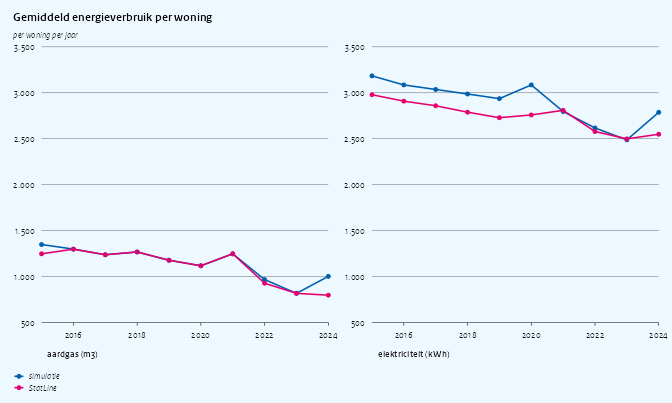
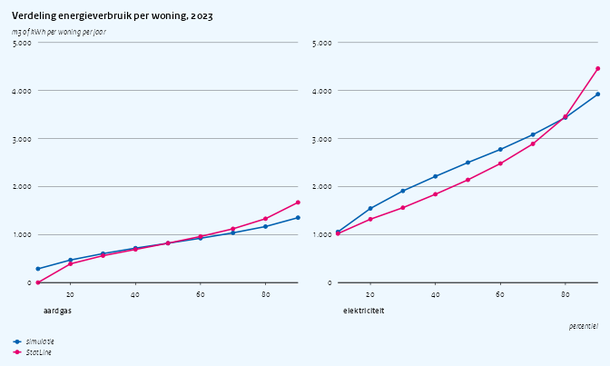
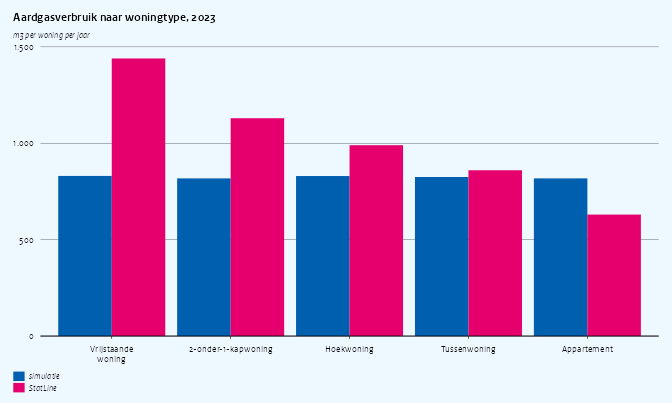
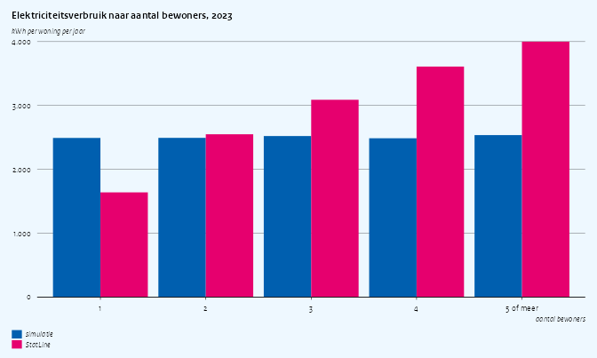
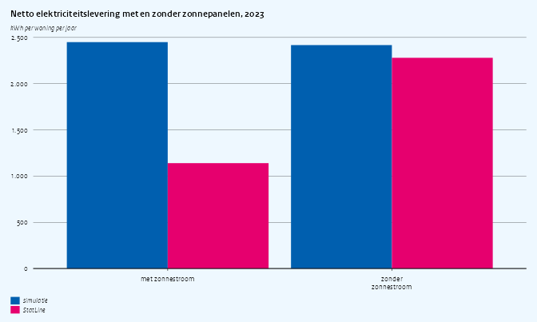

Simulation quality: energy use of dwellings
================

Third vignette in the simulation-quality series (after
`vignette("quality-cars")` and `vignette("quality-income")`). The
research question:

> **Which dwellings use the most gas and electricity, and how much do
> solar panels reduce the net electricity demand of a household?**

On the real microdata this is answered with `ENERGIEVERBRUIK{YYYY}TABV1`
(annual gas and electricity per dwelling) linked on `RINOBJECTNUMMER` to
the dwelling characteristics in woonbase. The published aggregates of
the same register are in StatLine 85140NED (by dwelling type, floor
area, construction year, number of occupants and solar panels, 2019
onwards) and 81528NED (national averages since 2010).

The short version: the national averages of gas and electricity use
roughly follow StatLine over time, because they are calibrated per year.
Everything the research question is actually about is not reproduced:
gas and electricity are drawn independently of the dwelling, so detached
houses use as much gas as apartments, old houses as much as new ones,
and a household of five as much electricity as a single person. Solar
panels have no effect on net electricity use, and the spread of the
distributions is too narrow. On top of that, the woonbase dwelling
characteristics used for the breakdown are themselves inconsistent (see
the last section).

## Setup

``` r
library(data.table)
library(haven)
library(ggplot2)
library(ggcpb)
library(simcbsradata)  # after haven, so read_sav() is the simulator's
```

`statline()` fetches a StatLine table with the dimension labels added,
retrying a few times on a dropped connection, and returns `NULL` when
StatLine cannot be reached; the plots then show the simulated series
only.

``` r
options(cbsodataR.base_url = "https://opendata.cbs.nl")

statline <- function(id, ..., tries = 3L) {
  for (i in seq_len(tries)) {
    dt <- tryCatch(
      suppressWarnings(as.data.table(cbsodataR::cbs_add_label_columns(
        cbsodataR::cbs_get_data(id, ...)))),
      error = function(e) {
        tcat("StatLine table ", id, " attempt ", i, " failed: ", conditionMessage(e))
        NULL
      })
    if (!is.null(dt)) break
  }
  if (is.null(dt)) return(NULL)
  for (j in names(dt)) {
    if (is.factor(dt[[j]]) || is.character(dt[[j]])) {
      set(dt, j = j, value = trimws(as.character(dt[[j]])))
    }
  }
  dt
}

# first measure column whose name matches `pattern`
measure <- function(dt, pattern) {
  col <- grep(pattern, names(dt), value = TRUE)[1]
  if (is.na(col)) stop("no column matching ", pattern)
  as.numeric(dt[[col]])
}

YEAR <- 2023L
```

### Simulated data

One record per dwelling in `ENERGIEVERBRUIK`, joined to the dwelling
type and occupancy (`WoonbasePopulatieWoonruimten`) and the construction
year and floor area (`WoonbaseKenmerkenWoonruimten`).

``` r
sim_reset()
woonbase_init(year = YEAR, n = 50000L, seed = 42L)
sim_init("energieverbruik", year = YEAR, seed = 43L)

energie <- as.data.table(read_sav(
  sprintf("ENERGIEVERBRUIK%dTABV1", YEAR),
  col_select = c(RINOBJECTNUMMER, GAS, ELEK, ELEKTERUG, ELEKNETTO, ZONPV, STADSW)))
woonr <- as.data.table(read_sav(
  sprintf("WoonbasePopulatieWoonruimten%dV1", YEAR),
  col_select = c(RINOBJECTNUMMER, VBOWoningType1Jan, AantalPersonenPerVSLKlasse1Jan)))
kenm <- as.data.table(read_sav(
  sprintf("WoonbaseKenmerkenWoonruimten%dV1", YEAR),
  col_select = c(RINOBJECTNUMMER, VBOBouwjaar1Jan, VBOOppervlakte1Jan)))

energie[, `:=`(
  gas      = as.numeric(GAS),
  elek     = as.numeric(ELEK),
  terug    = as.numeric(ELEKTERUG),
  netto    = as.numeric(ELEKNETTO),
  zon      = as.character(cbs_code(ZONPV)) == "1",
  stadsw   = as.character(cbs_code(STADSW)) == "1"
)]
energie[woonr, on = "RINOBJECTNUMMER", `:=`(
  woningtype = as.character(as_factor(i.VBOWoningType1Jan)),
  bewoners   = as.character(as_factor(i.AantalPersonenPerVSLKlasse1Jan)))]
energie[kenm, on = "RINOBJECTNUMMER", `:=`(
  bouwjaar   = as.integer(i.VBOBouwjaar1Jan),
  oppervlak  = as.numeric(i.VBOOppervlakte1Jan))]
```

The dwelling characteristics are put into the classes of 85140NED.
Construction-year and floor-area classes are matched on their lower
bound, which works for both the simulated values and the StatLine
labels.

``` r
TYPES <- c("Vrijstaande woning", "2-onder-1-kapwoning", "Hoekwoning",
           "Tussenwoning", "Appartement")
energie[, woningtype := fcase(
  woningtype == "Vrijstaande woning",       "Vrijstaande woning",
  woningtype == "Twee-onder-een-kapwoning", "2-onder-1-kapwoning",
  woningtype == "Hoekwoning",               "Hoekwoning",
  woningtype == "Tussenwoning",             "Tussenwoning",
  woningtype == "Meergezinswoning",         "Appartement"
)]

BJ_LOWER <- c(1000, 1946, 1965, 1975, 1992, 2006, 2015)
BJ_LABEL <- c("voor 1946", "1946-1964", "1965-1974", "1975-1991",
              "1992-2005", "2006-2014", "2015 en later")
OPP_LOWER <- c(2, 50, 75, 100, 150, 250)
OPP_LABEL <- c("< 50 m2", "50-75 m2", "75-100 m2", "100-150 m2",
               "150-250 m2", ">= 250 m2")

# class of a value given the lower bounds of the classes
klasse <- function(x, lower, labels) {
  factor(labels[findInterval(x, lower)], levels = labels)
}
# class of a StatLine label from the first number in it
klasse_label <- function(lbl, lower, labels) {
  first <- as.numeric(sub("^\\D*(\\d+).*$", "\\1", gsub(" ", "", lbl)))
  factor(labels[match(first, lower)], levels = labels)
}

energie[, `:=`(
  bouwjaarklasse  = klasse(bouwjaar, BJ_LOWER, BJ_LABEL),
  oppervlakklasse = klasse(oppervlak, OPP_LOWER, OPP_LABEL),
  bewonersklasse  = fcase(bewoners == "1", "1", bewoners == "2", "2",
                          bewoners == "3", "3", bewoners == "4", "4",
                          bewoners %in% c("5", "6-9", ">=10"), "5 of meer")
)]
```

### StatLine reference tables

| Table    | Content                                                                                                                                                                                                               |
|----------|-----------------------------------------------------------------------------------------------------------------------------------------------------------------------------------------------------------------------|
| 85140NED | Mean and percentiles of gas (temperature corrected) and electricity per dwelling, by dwelling type, floor area, construction year, number of occupants and solar panels; share with solar panels and district heating |
| 81528NED | National mean gas and electricity use per dwelling, 2010 onwards                                                                                                                                                      |

``` r
sl <- statline("85140NED", Perioden = paste0(YEAR, "JJ00"))
sl_trend <- statline("81528NED", RegioS = cbsodataR::has_substring("NL01"))
has_statline <- !is.null(sl) && !is.null(sl_trend)
tcat("StatLine reachable: ", has_statline)
#> [2026-10-20 14:35:35] StatLine reachable: TRUE

# one-way breakdowns: every other dimension at its total
one_way <- function(dim) {
  dims <- c("Woningtype", "Gebruiksoppervlakte", "Bouwjaar", "Bewonersklasse",
            "HoofdverwarmingEnZonnestroom")
  lab <- paste0(dims, "_label")
  keep <- rep(TRUE, nrow(sl))
  for (d in setdiff(dims, dim)) {
    keep <- keep & grepl("^Totaal", sl[[paste0(d, "_label")]]) &
      !grepl("met|zonder", sl[[paste0(d, "_label")]])
  }
  sl[keep]
}
```

## National averages over time

Gas and electricity use per dwelling are calibrated per year, so the
national trend should follow 81528NED. We simulate a smaller population
for every year.

``` r
TREND_YEARS <- 2015:2024
sim_trend <- rbindlist(lapply(TREND_YEARS, function(y) {
  sim_reset()
  woonbase_init(year = y, n = 10000L, seed = 42L)
  sim_init("energieverbruik", year = y, seed = 43L)
  e <- as.data.table(read_sav(sprintf("ENERGIEVERBRUIK%dTABV1", y),
                              col_select = c(GAS, ELEK)))
  data.table(jaar = y, bron = "simulatie",
             gas = mean(as.numeric(e$GAS)), elek = mean(as.numeric(e$ELEK)))
}))

sl_tr <- if (has_statline) {
  tr <- sl_trend[Woningkenmerken_label == "Totaal woningen"]
  tr[, .(jaar = as.integer(Perioden_label), bron = "StatLine",
         gas = measure(.SD, "^GemiddeldAardgasverbruik"),
         elek = measure(.SD, "^GemiddeldeElektriciteitslevering"))][
    jaar %in% TREND_YEARS]
}
trend <- melt(rbindlist(list(sim_trend, sl_tr), use.names = TRUE),
              id.vars = c("jaar", "bron"), variable.name = "drager", value.name = "verbruik")
trend[, drager := factor(fifelse(drager == "gas", "aardgas (m3)", "elektriciteit (kWh)"),
                         levels = c("aardgas (m3)", "elektriciteit (kWh)"))]

cpb_line(trend, x = jaar, y = verbruik, colour = bron,
  points       = TRUE,
  facet        = drager,
  facet_scales = "free_y",
  title = "Gemiddeld energieverbruik per woning",
  ylab  = "per woning per jaar")
```



Gas follows the published decline from 2016 to 2023; the 2024 parameter
is too high. Electricity is a few hundred kWh too high before 2021 and
again in 2024. The yearly means in
`inst/config/datasets/energieverbruik/params.yaml` for those years are
estimates rather than StatLine values.

## Distribution: percentiles

85140NED publishes the 10th to 90th percentiles. For gas these are
temperature corrected; the simulated `GAS` is the actual delivery, which
in 2023 differs from the corrected value by a few percent.

``` r
sim_pct <- energie[, .(
  percentiel = seq(10, 90, 10),
  aardgas = quantile(gas, seq(0.1, 0.9, 0.1)),
  elektriciteit = quantile(elek, seq(0.1, 0.9, 0.1)),
  bron = "simulatie")]
sl_pct <- if (has_statline) {
  tot <- one_way("none")
  data.table(
    percentiel = seq(10, 90, 10),
    aardgas = vapply(seq(10, 90, 10), function(p)
      measure(tot, paste0("^AardgasTempGecorrPercentiel", p, "_")), numeric(1)),
    elektriciteit = vapply(seq(10, 90, 10), function(p)
      measure(tot, paste0("^ElektriciteitsleveringPercentiel", p, "_")), numeric(1)),
    bron = "StatLine")
}
pct <- melt(rbindlist(list(sim_pct, sl_pct), use.names = TRUE),
            id.vars = c("percentiel", "bron"), variable.name = "drager", value.name = "verbruik")

cpb_line(pct, x = percentiel, y = verbruik, colour = bron,
  points       = TRUE,
  facet        = drager,
  facet_scales = "free_y",
  title = "Verdeling energieverbruik per woning, 2023",
  ylab  = "m3 of kWh per woning per jaar",
  xlab  = "percentiel")
```



The simulated distributions are too narrow at both ends. Real gas use
starts at zero (dwellings without a gas connection, about one in ten)
and has a long upper tail; electricity has a longer upper tail too.

## Gas use by dwelling characteristics

The core of the research question. Gas is mostly used for space heating,
so it rises with the size of the dwelling and the number of outside
walls, and falls with the construction year as insulation standards
tighten.

``` r
compare_by <- function(sim_col, sl_dim, levels, value = "gas",
                       sl_pattern = "^GemiddeldeAardgasleveringTempGecorr") {
  sim <- energie[!is.na(get(sim_col)),
                 .(gemiddeld = mean(get(value)), bron = "simulatie"),
                 by = .(klasse = as.character(get(sim_col)))]
  sl_part <- if (has_statline) {
    d <- one_way(sl_dim)
    d <- d[!grepl("^Totaal|nbekend", get(paste0(sl_dim, "_label")))]
    lbl <- d[[paste0(sl_dim, "_label")]]
    d[, klasse := as.character(switch(sl_dim,
      Woningtype          = lbl,
      Bouwjaar            = klasse_label(lbl, BJ_LOWER, BJ_LABEL),
      Gebruiksoppervlakte = klasse_label(lbl, OPP_LOWER, OPP_LABEL),
      Bewonersklasse      = sub(" personen of meer", " of meer", sub(" perso(o|ne)n?$", "", lbl))))]
    d[, .(klasse, gemiddeld = measure(.SD, sl_pattern), bron = "StatLine")]
  }
  out <- rbindlist(list(sim, sl_part), use.names = TRUE)
  out[klasse %in% levels][, klasse := factor(klasse, levels = levels)]
}

gas_type <- compare_by("woningtype", "Woningtype", TYPES)
cpb_col(gas_type, x = klasse, y = gemiddeld, fill = bron,
  position = "dodge", reverse_legend = FALSE,
  title = "Aardgasverbruik naar woningtype, 2023",
  ylab  = "m3 per woning per jaar")
```



``` r

gas_bj <- compare_by("bouwjaarklasse", "Bouwjaar", BJ_LABEL)
cpb_col(gas_bj, x = klasse, y = gemiddeld, fill = bron,
  position = "dodge", reverse_legend = FALSE,
  title = "Aardgasverbruik naar bouwjaar, 2023",
  ylab  = "m3 per woning per jaar")
```


``` r

gas_opp <- compare_by("oppervlakklasse", "Gebruiksoppervlakte", OPP_LABEL)
cpb_col(gas_opp, x = klasse, y = gemiddeld, fill = bron,
  position = "dodge", reverse_legend = FALSE,
  title = "Aardgasverbruik naar gebruiksoppervlakte, 2023",
  ylab  = "m3 per woning per jaar")
```


In the simulator every group uses the national average. The real
gradients are large: a detached house uses well over twice the gas of an
apartment, and dwellings of over 250 m2 several times that of the
smallest ones. Any analysis of who would be hit by a gas tax, or which
dwellings to insulate first, gives a flat answer on the simulated data.

## Electricity use by number of occupants

``` r
elek_bew <- compare_by("bewonersklasse", "Bewonersklasse",
                       c("1", "2", "3", "4", "5 of meer"),
                       value = "elek", sl_pattern = "^GemiddeldeElektriciteitslevering")
cpb_col(elek_bew, x = klasse, y = gemiddeld, fill = bron,
  position = "dodge", reverse_legend = FALSE,
  title = "Elektriciteitsverbruik naar aantal bewoners, 2023",
  ylab  = "kWh per woning per jaar",
  xlab  = "aantal bewoners")
```



Electricity is drawn independently of the household as well.

## Solar panels and net electricity use

The share of dwellings with solar panels is calibrated per year. The
second half of the research question, how much they reduce net
electricity demand, depends on `ELEKNETTO` being lower for dwellings
with panels.

``` r
sim_zon <- energie[, .(
  bron = "simulatie",
  zonnepanelen = c("met zonnestroom", "zonder zonnestroom"),
  netto = c(mean(netto[zon]), mean(netto[!zon])),
  terug = c(mean(terug[zon]), mean(terug[!zon])))]
sl_zon <- if (has_statline) {
  d <- one_way("HoofdverwarmingEnZonnestroom")
  d <- d[grepl("^Totaal (met|zonder) zonnestroom", HoofdverwarmingEnZonnestroom_label)]
  d[, .(bron = "StatLine",
        zonnepanelen = fifelse(grepl("zonder", HoofdverwarmingEnZonnestroom_label),
                               "zonder zonnestroom", "met zonnestroom"),
        netto = measure(.SD, "^NettoElektriciteitsleveringGemiddelde"),
        terug = NA_real_)]
}
zon <- rbindlist(list(sim_zon, sl_zon), use.names = TRUE)
zon[, .(bron, zonnepanelen, netto, terug)]
#>         bron       zonnepanelen    netto    terug
#> 1: simulatie    met zonnestroom 2449.696 772.5411
#> 2: simulatie zonder zonnestroom 2417.575 773.8959
#> 3:  StatLine    met zonnestroom 1140.000       NA
#> 4:  StatLine zonder zonnestroom 2280.000       NA

cpb_col(zon, x = zonnepanelen, y = netto, fill = bron,
  position = "dodge", reverse_legend = FALSE,
  title = "Netto elektriciteitslevering met en zonder zonnepanelen, 2023",
  ylab  = "kWh per woning per jaar")
```



``` r
sim_share <- energie[, .(bron = "simulatie",
                         zonnestroom = mean(zon) * 100, stadsverwarming = mean(stadsw) * 100)]
sl_share <- if (has_statline) {
  tot <- one_way("none")
  tot[, .(bron = "StatLine",
          zonnestroom = measure(.SD, "^AandeelWoningenZonnestroomOpAdres"),
          stadsverwarming = measure(.SD, "^AandeelWoningenMetStadsverwarming"))]
}
rbindlist(list(sim_share, sl_share), use.names = TRUE)
#>         bron zonnestroom stadsverwarming
#> 1: simulatie    31.54025        5.757654
#> 2:  StatLine    33.00000        6.900000
```

The shares match, but in the simulator net electricity is the same with
and without panels, and the feed-in (`ELEKTERUG`) is as high for
dwellings without panels as for dwellings with them. `ELEK`, `ELEKTERUG`
and `ELEKNETTO` are drawn independently of each other and of `ZONPV`:

``` r
energie[, .(
  netto_gelijk_aan_levering_min_terug = mean(abs(netto - (elek - terug)) < 1) * 100,
  terug_zonder_panelen = mean(terug[!zon] > 0) * 100)]
#>    netto_gelijk_aan_levering_min_terug terug_zonder_panelen
#> 1:                         0.004299966             66.40286
```

## Dwelling characteristics

The breakdowns above lean on woonbase for the construction year and
floor area of each dwelling. Those columns turn out to be inconsistent
with each other:

``` r
woonr2 <- as.data.table(read_sav(
  sprintf("WoonbasePopulatieWoonruimten%dV1", YEAR),
  col_select = c(RINOBJECTNUMMER, VBOBouwJaarKlasse1Jan, VBOOppervlakteKlasse1Jan)))
kenm2 <- as.data.table(read_sav(
  sprintf("WoonbaseKenmerkenWoonruimten%dV1", YEAR),
  col_select = c(RINOBJECTNUMMER, VBOBouwjaar1Jan, VBOBouwjaar31Dec,
                 VBOOppervlakte1Jan, VBOOppervlakte31Dec)))
dw <- merge(woonr2, kenm2, by = "RINOBJECTNUMMER")

# is a value inside a class label such as "<1905", "1905-1925", ">=250 m2"?
in_klasse <- function(x, lbl) {
  lbl <- sub(" m2$", "", lbl)
  num <- function(v) suppressWarnings(as.numeric(v))
  lo <- fifelse(grepl("^<", lbl), -Inf, num(sub("^>=", "", sub("-.*", "", lbl))))
  hi <- fifelse(grepl("^>=", lbl), Inf, num(sub("^<", "", sub(".*-", "", lbl))))
  x >= lo & x < hi
}

dw[, .(
  bouwjaar_in_klasse      = mean(in_klasse(as.numeric(VBOBouwjaar1Jan),
                                  as.character(as_factor(VBOBouwJaarKlasse1Jan))), na.rm = TRUE) * 100,
  oppervlakte_in_klasse   = mean(in_klasse(as.numeric(VBOOppervlakte1Jan),
                                  as.character(as_factor(VBOOppervlakteKlasse1Jan))), na.rm = TRUE) * 100,
  bouwjaar_1jan_31dec_gelijk    = mean(VBOBouwjaar1Jan == VBOBouwjaar31Dec) * 100,
  oppervlakte_1jan_31dec_gelijk = mean(VBOOppervlakte1Jan == VBOOppervlakte31Dec) * 100,
  klasse_na_simulatiejaar = mean(as.character(as_factor(VBOBouwJaarKlasse1Jan)) %in%
                                   c("2025-2030", "2030-2035", ">=2035")) * 100
)]
#>    bouwjaar_in_klasse oppervlakte_in_klasse bouwjaar_1jan_31dec_gelijk
#> 1:           7.387057              20.54542                  0.6919007
#>    oppervlakte_1jan_31dec_gelijk klasse_na_simulatiejaar
#> 1:                     0.6512007                1.689052
```

- The class columns (`VBOBouwJaarKlasse`, `VBOOppervlakteKlasse`) are
  drawn separately from the values they classify, so a dwelling’s
  construction year falls in its own class only by chance. Some classes
  even lie after the simulation year.
- The construction year and floor area are drawn again for 31 December,
  so the same dwelling has a different construction year at the start
  and the end of the year (and in every simulation year).
- The construction year is uniform between 1850 and the simulation year,
  so the age profile of the housing stock is wrong as well.

Analyses by construction year or floor area (new construction, the
effect of building regulations, energy use per m2) are affected for any
dataset that links to woonbase dwellings, not only for energy.

## Summary

| Moment                                    | Source in simulator                 | Matches StatLine?                                                          | Safe for research? |
|-------------------------------------------|-------------------------------------|----------------------------------------------------------------------------|--------------------|
| Mean gas and electricity per year         | calibrated (params.yaml)            | gas 2016-2023 yes; electricity too high before 2021, both too high in 2024 | with care          |
| Share with solar panels                   | calibrated (params.yaml)            | close                                                                      | yes                |
| Share with district heating               | calibrated (params.yaml)            | close                                                                      | yes                |
| Spread of gas and electricity use         | normal, hand-set sd                 | no, too narrow                                                             | no                 |
| Gas by dwelling type, size, age           | independent of dwelling             | no                                                                         | no                 |
| Electricity by number of occupants        | independent of household            | no                                                                         | no                 |
| Net electricity with solar panels         | independent of `ZONPV`              | no                                                                         | no                 |
| `ELEK - ELEKTERUG = ELEKNETTO`            | independent draws                   | no                                                                         | no                 |
| Dwelling construction year and floor area | independent draws, redrawn per date | no                                                                         | no                 |

For this research question the simulator supports building the pipeline
(linking `ENERGIEVERBRUIK` to woonbase on `RINOBJECTNUMMER`, classifying
dwellings, computing group means) but not the answer: every breakdown
the question asks for comes out flat. The improvements that would change
that are drawing gas and electricity conditional on dwelling type, floor
area, construction year and occupants (85140NED has all of these one
way), deriving net electricity from delivery and feed-in with feed-in
only for dwellings with panels, and making the woonbase construction
year and floor area stable per dwelling with classes derived from the
values.
