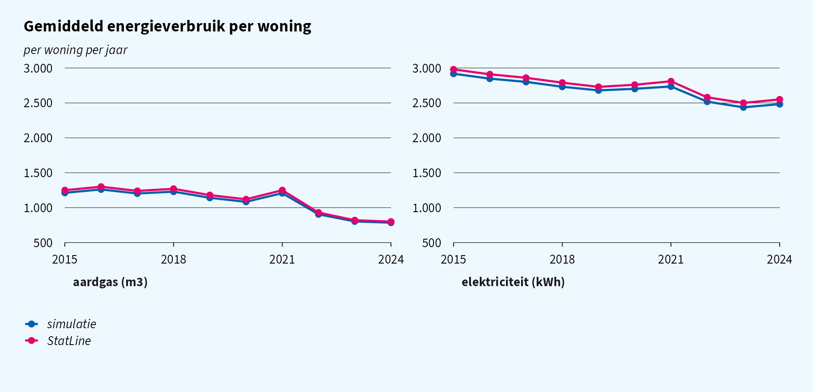
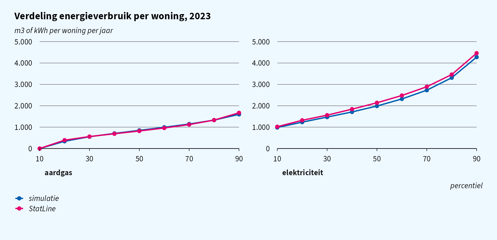
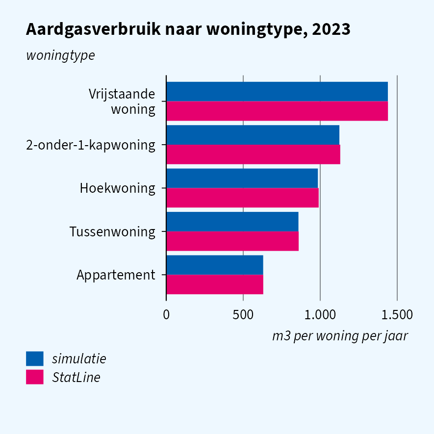
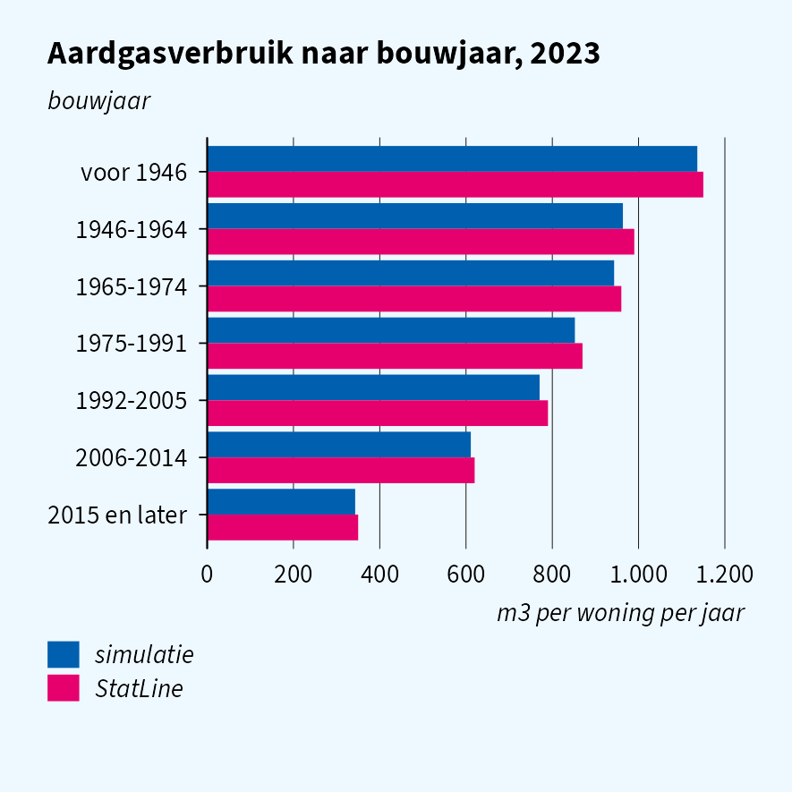
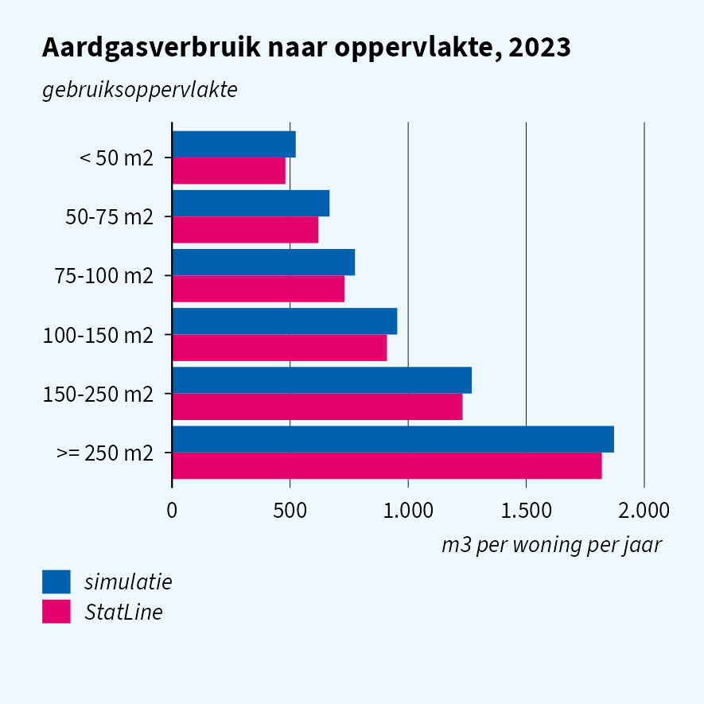
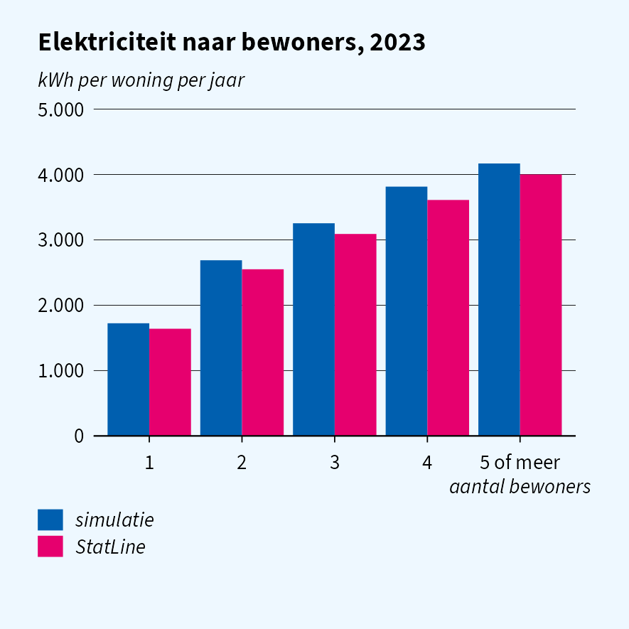
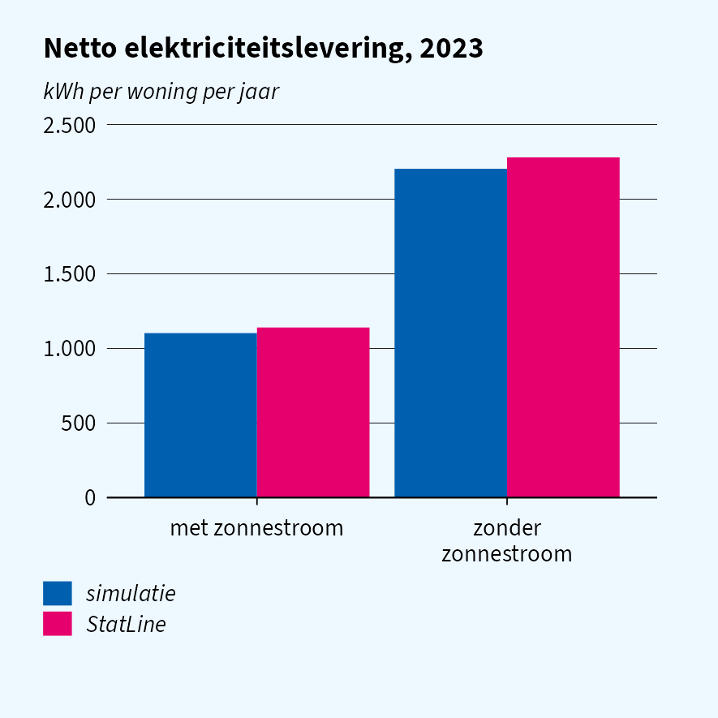
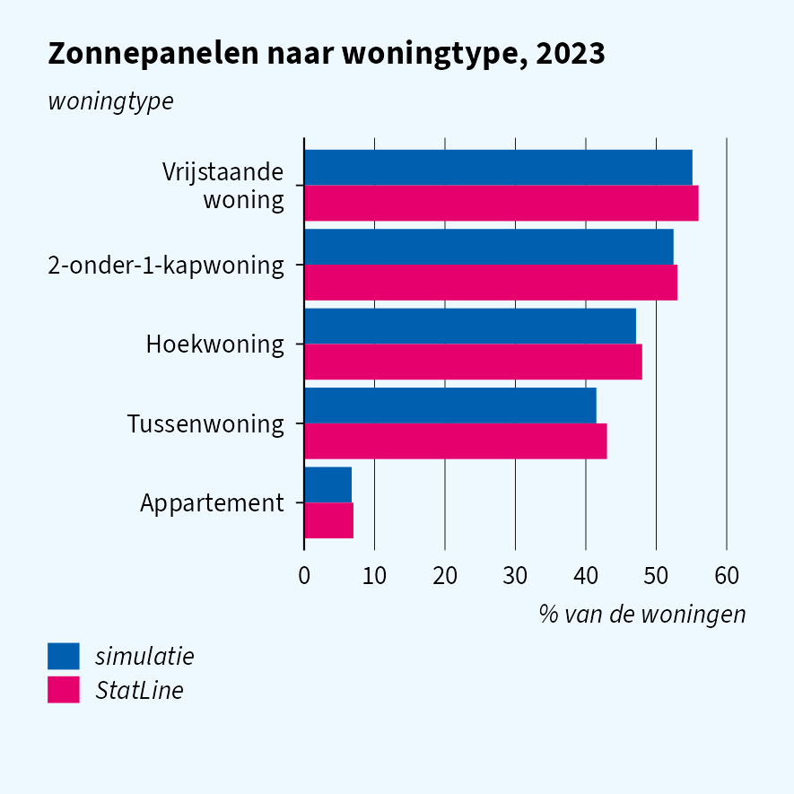

Simulation quality: energy use of dwellings
================

Third vignette in the simulation-quality series (after
`vignette("quality-cars")` and `vignette("quality-income")`). The
research question:

> **Which dwellings use the most gas and electricity, and how much do
> solar panels reduce the net electricity demand of a household?**

On the real microdata this is answered with `ENERGIEVERBRUIK{YYYY}TABV1`
(annual gas and electricity per dwelling) linked on `RINOBJECTNUMMER` to
the dwelling characteristics in woonbase. The published aggregates of
the same register are in StatLine 85140NED (by dwelling type, floor
area, construction year, number of occupants and solar panels, 2019
onwards) and 81528NED (national averages since 2010).

The short version: gas and electricity are generated per dwelling from
its type, construction year, floor area, number of occupants and solar
panels, calibrated to 85140NED, so the gradients the question is about
are reproduced, as are the percentiles and the effect of solar panels on
net electricity use. National averages are a few percent low, because
the simulated housing stock has more small dwellings and single-person
households than the real one.

## Setup

``` r
library(data.table)
library(haven)
library(ggplot2)
library(ggcpb)
library(simregdata)  # after haven, so read_sav() is the simulator's
```

Figures are written with `save_cpb()` at the CPB page width (half page,
7.5 cm, unless noted) and shown at half size, as in the ggcpb vignettes.
They use ggcpb’s open fallback font, Source Sans 3, instead of the
Rijksoverheid font.

``` r
options(ggcpb.font_path = character(0), ggcpb.font_warning = FALSE)
cpb_register_fonts(enable_showtext = FALSE)

# write `p` with save_cpb() next to knitr's own figures and include it
show_cpb <- function(p, name, page = "half", height = NULL) {
  file <- file.path(dirname(knitr::fig_path()), paste0(name, ".png"))
  dir.create(dirname(file), recursive = TRUE, showWarnings = FALSE)
  save_cpb(file, p, page = page, height = height)
  knitr::include_graphics(file)
}

# horizontal bars: first category at the top, simulatie above StatLine
# (pass colour_index = c(2, 6) to keep the colours of the other figures)
flip <- function(d, x) {
  d <- copy(d)
  d[, (x) := factor(get(x), levels = rev(levels(factor(get(x)))))]
  d[, bron := factor(bron, levels = c("StatLine", "simulatie"))]
  d
}
```

`statline()` fetches a StatLine table with the dimension labels added,
retrying a few times on a dropped connection, and returns `NULL` when
StatLine cannot be reached; the plots then show the simulated series
only.

``` r
options(cbsodataR.base_url = "https://opendata.cbs.nl")

statline <- function(id, ..., tries = 3L) {
  for (i in seq_len(tries)) {
    dt <- tryCatch(
      suppressWarnings(as.data.table(cbsodataR::cbs_add_label_columns(
        cbsodataR::cbs_get_data(id, ...)))),
      error = function(e) {
        tcat("StatLine table ", id, " attempt ", i, " failed: ", conditionMessage(e))
        NULL
      })
    if (!is.null(dt)) break
  }
  if (is.null(dt)) return(NULL)
  for (j in names(dt)) {
    if (is.factor(dt[[j]]) || is.character(dt[[j]])) {
      set(dt, j = j, value = trimws(as.character(dt[[j]])))
    }
  }
  dt
}

# first measure column whose name matches `pattern`
measure <- function(dt, pattern) {
  col <- grep(pattern, names(dt), value = TRUE)[1]
  if (is.na(col)) stop("no column matching ", pattern)
  as.numeric(dt[[col]])
}

YEAR <- 2023L
```

### Simulated data

One record per dwelling in `ENERGIEVERBRUIK`, joined to the dwelling
type and occupancy (`WoonbasePopulatieWoonruimten`) and the construction
year and floor area (`WoonbaseKenmerkenWoonruimten`).

``` r
sim_reset()
woonbase_init(year = YEAR, n = 50000L, seed = 42L)
sim_init("energieverbruik", year = YEAR, seed = 43L)

energie <- as.data.table(read_sav(
  sprintf("ENERGIEVERBRUIK%dTABV1", YEAR),
  col_select = c(RINOBJECTNUMMER, GASSJV, ELEK, ELEKTERUG, ELEKNETTO, ZONPV, STADSW)))
woonr <- as.data.table(read_sav(
  sprintf("WoonbasePopulatieWoonruimten%dV1", YEAR),
  col_select = c(RINOBJECTNUMMER, VBOWoningType1Jan, AantalPersonenPerVSLKlasse1Jan)))
kenm <- as.data.table(read_sav(
  sprintf("WoonbaseKenmerkenWoonruimten%dV1", YEAR),
  col_select = c(RINOBJECTNUMMER, VBOBouwjaar1Jan, VBOOppervlakte1Jan)))

# 85140NED reports temperature-corrected gas use, which is GASSJV; GAS is the
# actual delivery in the year
energie[, `:=`(
  gas      = as.numeric(GASSJV),
  elek     = as.numeric(ELEK),
  terug    = as.numeric(ELEKTERUG),
  netto    = as.numeric(ELEKNETTO),
  zon      = as.character(cbs_code(ZONPV)) == "1",
  stadsw   = as.character(cbs_code(STADSW)) == "1"
)]
energie[woonr, on = "RINOBJECTNUMMER", `:=`(
  woningtype = as.character(as_factor(i.VBOWoningType1Jan)),
  bewoners   = as.character(as_factor(i.AantalPersonenPerVSLKlasse1Jan)))]
energie[kenm, on = "RINOBJECTNUMMER", `:=`(
  bouwjaar   = as.integer(i.VBOBouwjaar1Jan),
  oppervlak  = as.numeric(i.VBOOppervlakte1Jan))]
```

The dwelling characteristics are put into the classes of 85140NED.
Construction-year and floor-area classes are matched on their lower
bound, which works for both the simulated values and the StatLine
labels.

``` r
TYPES <- c("Vrijstaande woning", "2-onder-1-kapwoning", "Hoekwoning",
           "Tussenwoning", "Appartement")
energie[, woningtype := fcase(
  woningtype == "Vrijstaande woning",       "Vrijstaande woning",
  woningtype == "Twee-onder-een-kapwoning", "2-onder-1-kapwoning",
  woningtype == "Hoekwoning",               "Hoekwoning",
  woningtype == "Tussenwoning",             "Tussenwoning",
  woningtype == "Meergezinswoning",         "Appartement"
)]

BJ_LOWER <- c(1000, 1946, 1965, 1975, 1992, 2006, 2015)
BJ_LABEL <- c("voor 1946", "1946-1964", "1965-1974", "1975-1991",
              "1992-2005", "2006-2014", "2015 en later")
OPP_LOWER <- c(2, 50, 75, 100, 150, 250)
OPP_LABEL <- c("< 50 m2", "50-75 m2", "75-100 m2", "100-150 m2",
               "150-250 m2", ">= 250 m2")

# class of a value given the lower bounds of the classes
klasse <- function(x, lower, labels) {
  factor(labels[findInterval(x, lower)], levels = labels)
}
# class of a StatLine label from the first number in it
klasse_label <- function(lbl, lower, labels) {
  first <- as.numeric(sub("^\\D*(\\d+).*$", "\\1", gsub(" ", "", lbl)))
  factor(labels[match(first, lower)], levels = labels)
}

energie[, `:=`(
  bouwjaarklasse  = klasse(bouwjaar, BJ_LOWER, BJ_LABEL),
  oppervlakklasse = klasse(oppervlak, OPP_LOWER, OPP_LABEL),
  bewonersklasse  = fcase(bewoners == "1", "1", bewoners == "2", "2",
                          bewoners == "3", "3", bewoners == "4", "4",
                          bewoners %in% c("5", "6-9", ">=10"), "5 of meer")
)]
```

### StatLine reference tables

| Table    | Content                                                                                                                                                                                                               |
|----------|-----------------------------------------------------------------------------------------------------------------------------------------------------------------------------------------------------------------------|
| 85140NED | Mean and percentiles of gas (temperature corrected) and electricity per dwelling, by dwelling type, floor area, construction year, number of occupants and solar panels; share with solar panels and district heating |
| 81528NED | National mean gas and electricity use per dwelling, 2010 onwards                                                                                                                                                      |

``` r
sl <- statline("85140NED", Perioden = paste0(YEAR, "JJ00"))
sl_trend <- statline("81528NED", RegioS = cbsodataR::has_substring("NL01"))
has_statline <- !is.null(sl) && !is.null(sl_trend)
tcat("StatLine reachable: ", has_statline)
#> [2026-10-23 10:05:23] StatLine reachable: TRUE

# one-way breakdowns: every other dimension at its total
one_way <- function(dim) {
  dims <- c("Woningtype", "Gebruiksoppervlakte", "Bouwjaar", "Bewonersklasse",
            "HoofdverwarmingEnZonnestroom")
  lab <- paste0(dims, "_label")
  keep <- rep(TRUE, nrow(sl))
  for (d in setdiff(dims, dim)) {
    keep <- keep & grepl("^Totaal", sl[[paste0(d, "_label")]]) &
      !grepl("met|zonder", sl[[paste0(d, "_label")]])
  }
  sl[keep]
}
```

## National averages over time

The national level per year comes from 81528NED (actual, not temperature
corrected, gas use: the simulated `GAS`). We simulate a smaller
population for every year.

``` r
TREND_YEARS <- 2015:2024
sim_trend <- rbindlist(lapply(TREND_YEARS, function(y) {
  sim_reset()
  woonbase_init(year = y, n = 10000L, seed = 42L)
  sim_init("energieverbruik", year = y, seed = 43L)
  e <- as.data.table(read_sav(sprintf("ENERGIEVERBRUIK%dTABV1", y),
                              col_select = c(GAS, ELEK)))
  data.table(jaar = y, bron = "simulatie",
             gas = mean(as.numeric(e$GAS)), elek = mean(as.numeric(e$ELEK)))
}))

sl_tr <- if (has_statline) {
  tr <- sl_trend[Woningkenmerken_label == "Totaal woningen"]
  tr[, .(jaar = as.integer(Perioden_label), bron = "StatLine",
         gas = measure(.SD, "^GemiddeldAardgasverbruik"),
         elek = measure(.SD, "^GemiddeldeElektriciteitslevering"))][
    jaar %in% TREND_YEARS]
}
trend <- melt(rbindlist(list(sim_trend, sl_tr), use.names = TRUE),
              id.vars = c("jaar", "bron"), variable.name = "drager", value.name = "verbruik")
trend[, drager := factor(fifelse(drager == "gas", "aardgas (m3)", "elektriciteit (kWh)"),
                         levels = c("aardgas (m3)", "elektriciteit (kWh)"))]

p <- cpb_line(trend, x = jaar, y = verbruik, colour = bron,
  points       = TRUE,
  facet        = drager,
  facet_scales = "free_y",
  title = "Gemiddeld energieverbruik per woning",
  ylab  = "per woning per jaar")
show_cpb(p, "trend", page = "full")
#> [2026-10-23 10:06:23] ggcpb: wrote quality-energy_files/figure-gfm/trend.png (6.1 x 2.95 in, 300 dpi)
```



Both follow the published series a few percent low. The dwelling-level
model targets the mean *within* every dwelling type, construction year,
floor area and household size, and the simulated stock has relatively
more of the small, low-use dwellings and single-person households, so
the national mean comes out lower. The fit spreads that mismatch over
all margins rather than matching some exactly and missing others by
more.

## Distribution: percentiles

85140NED publishes the 10th to 90th percentiles (gas temperature
corrected, compared with `GASSJV`).

``` r
sim_pct <- energie[, .(
  percentiel = seq(10, 90, 10),
  aardgas = quantile(gas, seq(0.1, 0.9, 0.1)),
  elektriciteit = quantile(elek, seq(0.1, 0.9, 0.1)),
  bron = "simulatie")]
sl_pct <- if (has_statline) {
  tot <- one_way("none")
  data.table(
    percentiel = seq(10, 90, 10),
    aardgas = vapply(seq(10, 90, 10), function(p)
      measure(tot, paste0("^AardgasTempGecorrPercentiel", p, "_")), numeric(1)),
    elektriciteit = vapply(seq(10, 90, 10), function(p)
      measure(tot, paste0("^ElektriciteitsleveringPercentiel", p, "_")), numeric(1)),
    bron = "StatLine")
}
pct <- melt(rbindlist(list(sim_pct, sl_pct), use.names = TRUE),
            id.vars = c("percentiel", "bron"), variable.name = "drager", value.name = "verbruik")

p <- cpb_line(pct, x = percentiel, y = verbruik, colour = bron,
  points       = TRUE,
  facet        = drager,
  facet_scales = "free_y",
  title = "Verdeling energieverbruik per woning, 2023",
  ylab  = "m3 of kWh per woning per jaar",
  xlab  = "percentiel")
show_cpb(p, "percentiles", page = "full")
#> [2026-10-23 10:06:24] ggcpb: wrote quality-energy_files/figure-gfm/percentiles.png (6.1 x 2.95 in, 300 dpi)
```



Both distributions follow the published percentiles, including the tenth
of dwellings without gas (district heating, most new dwellings, other
all-electric homes). Gas is slightly short at the top.

## Gas use by dwelling characteristics

The core of the research question. Gas is mostly used for space heating,
so it rises with the size of the dwelling and the number of outside
walls, and falls with the construction year as insulation standards
tighten.

``` r
compare_by <- function(sim_col, sl_dim, levels, value = "gas",
                       sl_pattern = "^GemiddeldeAardgasleveringTempGecorr") {
  sim <- energie[!is.na(get(sim_col)),
                 .(gemiddeld = mean(get(value)), bron = "simulatie"),
                 by = .(klasse = as.character(get(sim_col)))]
  sl_part <- if (has_statline) {
    d <- one_way(sl_dim)
    d <- d[!grepl("^Totaal|nbekend", get(paste0(sl_dim, "_label")))]
    lbl <- d[[paste0(sl_dim, "_label")]]
    d[, klasse := as.character(switch(sl_dim,
      Woningtype          = lbl,
      Bouwjaar            = klasse_label(lbl, BJ_LOWER, BJ_LABEL),
      Gebruiksoppervlakte = klasse_label(lbl, OPP_LOWER, OPP_LABEL),
      Bewonersklasse      = sub(" personen of meer", " of meer", sub(" perso(o|ne)n?$", "", lbl))))]
    d[, .(klasse, gemiddeld = measure(.SD, sl_pattern), bron = "StatLine")]
  }
  out <- rbindlist(list(sim, sl_part), use.names = TRUE)
  out[klasse %in% levels][, klasse := factor(klasse, levels = levels)]
}

gas_type <- compare_by("woningtype", "Woningtype", TYPES)
p <- cpb_col(flip(gas_type, "klasse"), x = klasse, y = gemiddeld, fill = bron,
  colour_index = c(2, 6),  # keep simulatie blue, StatLine magenta
  position = "dodge", orientation = "horizontal",
  title = "Aardgasverbruik naar woningtype, 2023",
  ylab  = "woningtype",
  xlab  = "m3 per woning per jaar")
show_cpb(p, "gas-by")
#> [2026-10-23 10:06:24] ggcpb: wrote quality-energy_files/figure-gfm/gas-by.png (2.95 x 2.95 in, 300 dpi)
```



``` r

gas_bj <- compare_by("bouwjaarklasse", "Bouwjaar", BJ_LABEL)
p <- cpb_col(flip(gas_bj, "klasse"), x = klasse, y = gemiddeld, fill = bron,
  colour_index = c(2, 6),  # keep simulatie blue, StatLine magenta
  position = "dodge", orientation = "horizontal",
  title = "Aardgasverbruik naar bouwjaar, 2023",
  ylab  = "bouwjaar",
  xlab  = "m3 per woning per jaar")
show_cpb(p, "gas-by-2")
#> [2026-10-23 10:06:25] ggcpb: wrote quality-energy_files/figure-gfm/gas-by-2.png (2.95 x 2.95 in, 300 dpi)
```



``` r

gas_opp <- compare_by("oppervlakklasse", "Gebruiksoppervlakte", OPP_LABEL)
p <- cpb_col(flip(gas_opp, "klasse"), x = klasse, y = gemiddeld, fill = bron,
  colour_index = c(2, 6),  # keep simulatie blue, StatLine magenta
  position = "dodge", orientation = "horizontal",
  title = "Aardgasverbruik naar oppervlakte, 2023",
  ylab  = "gebruiksoppervlakte",
  xlab  = "m3 per woning per jaar")
show_cpb(p, "gas-by-3")
#> [2026-10-23 10:06:25] ggcpb: wrote quality-energy_files/figure-gfm/gas-by-3.png (2.95 x 2.95 in, 300 dpi)
```



The gradients are reproduced: a detached house uses more than twice the
gas of an apartment, dwellings of over 250 m2 nearly four times that of
the smallest ones, and gas use falls steadily with the construction
year. Levels are a few percent low in some groups because the raking
cannot match all four characteristics exactly on a stock whose joint
distribution differs from the real one.

## Electricity use by number of occupants

``` r
elek_bew <- compare_by("bewonersklasse", "Bewonersklasse",
                       c("1", "2", "3", "4", "5 of meer"),
                       value = "elek", sl_pattern = "^GemiddeldeElektriciteitslevering")
p <- cpb_col(elek_bew, x = klasse, y = gemiddeld, fill = bron,
  position = "dodge", reverse_legend = FALSE,
  title = "Elektriciteit naar bewoners, 2023",
  ylab  = "kWh per woning per jaar",
  xlab  = "aantal bewoners")
show_cpb(p, "elek-by")
#> [2026-10-23 10:06:26] ggcpb: wrote quality-energy_files/figure-gfm/elek-by.png (2.95 x 2.95 in, 300 dpi)
```



Electricity rises with the number of occupants as in the published data,
about 5% high in every group (the counterpart of the low national mean).

## Solar panels and net electricity use

Solar panels are assigned with probabilities raked to the published
shares per dwelling type, floor area and number of occupants. Feed-in
(`ELEKTERUG`) exists only for dwellings with panels, proportional to
their capacity, and net electricity is delivery minus feed-in.

``` r
sim_zon <- energie[, .(
  bron = "simulatie",
  zonnepanelen = c("met zonnestroom", "zonder zonnestroom"),
  netto = c(mean(netto[zon]), mean(netto[!zon])),
  terug = c(mean(terug[zon]), mean(terug[!zon])))]
sl_zon <- if (has_statline) {
  d <- one_way("HoofdverwarmingEnZonnestroom")
  d <- d[grepl("^Totaal (met|zonder) zonnestroom", HoofdverwarmingEnZonnestroom_label)]
  d[, .(bron = "StatLine",
        zonnepanelen = fifelse(grepl("zonder", HoofdverwarmingEnZonnestroom_label),
                               "zonder zonnestroom", "met zonnestroom"),
        netto = measure(.SD, "^NettoElektriciteitsleveringGemiddelde"),
        terug = NA_real_)]
}
zon <- rbindlist(list(sim_zon, sl_zon), use.names = TRUE)
zon[, .(bron, zonnepanelen, netto, terug)]
#>         bron       zonnepanelen    netto   terug
#> 1: simulatie    met zonnestroom 1102.415 1750.33
#> 2: simulatie zonder zonnestroom 2203.572    0.00
#> 3:  StatLine    met zonnestroom 1140.000      NA
#> 4:  StatLine zonder zonnestroom 2280.000      NA

p <- cpb_col(zon, x = zonnepanelen, y = netto, fill = bron,
  position = "dodge", reverse_legend = FALSE,
  title = "Netto elektriciteitslevering, 2023",
  ylab  = "kWh per woning per jaar")
show_cpb(p, "solar")
#> [2026-10-23 10:06:26] ggcpb: wrote quality-energy_files/figure-gfm/solar.png (2.95 x 2.95 in, 300 dpi)
```



``` r
sim_share <- energie[, .(bron = "simulatie",
                         zonnestroom = mean(zon) * 100, stadsverwarming = mean(stadsw) * 100)]
sl_share <- if (has_statline) {
  tot <- one_way("none")
  tot[, .(bron = "StatLine",
          zonnestroom = measure(.SD, "^AandeelWoningenZonnestroomOpAdres"),
          stadsverwarming = measure(.SD, "^AandeelWoningenMetStadsverwarming"))]
}
rbindlist(list(sim_share, sl_share), use.names = TRUE)
#>         bron zonnestroom stadsverwarming
#> 1: simulatie    29.46766        6.910045
#> 2:  StatLine    33.00000        6.900000

energie[, zon_pct := zon * 100]
zon_type <- compare_by("woningtype", "Woningtype", TYPES, value = "zon_pct",
                       sl_pattern = "^AandeelWoningenZonnestroomOpAdres")
p <- cpb_col(flip(zon_type, "klasse"), x = klasse, y = gemiddeld, fill = bron,
  colour_index = c(2, 6),  # keep simulatie blue, StatLine magenta
  position = "dodge", orientation = "horizontal",
  title = "Zonnepanelen naar woningtype, 2023",
  ylab  = "woningtype",
  xlab  = "% van de woningen")
show_cpb(p, "solar-share")
#> [2026-10-23 10:06:27] ggcpb: wrote quality-energy_files/figure-gfm/solar-share.png (2.95 x 2.95 in, 300 dpi)
```



Net electricity of dwellings with panels is half that of dwellings
without, as published. The share per dwelling type matches; nationally
it is a few points low for the same composition reason as gas. The
electricity columns are consistent with each other:

``` r
energie[, .(
  netto_gelijk_aan_levering_min_terug = mean(abs(netto - (elek - terug)) < 1) * 100,
  terug_zonder_panelen = mean(terug[!zon] > 0) * 100)]
#>    netto_gelijk_aan_levering_min_terug terug_zonder_panelen
#> 1:                                 100                    0
```

## Dwelling characteristics

The breakdowns above lean on woonbase for the construction year and
floor area of each dwelling. A check that these are usable: the classes
contain the values, the values are the same on 1 January and 31
December, and no dwelling is built after the simulation year.

``` r
woonr2 <- as.data.table(read_sav(
  sprintf("WoonbasePopulatieWoonruimten%dV1", YEAR),
  col_select = c(RINOBJECTNUMMER, VBOBouwJaarKlasse1Jan, VBOOppervlakteKlasse1Jan)))
kenm2 <- as.data.table(read_sav(
  sprintf("WoonbaseKenmerkenWoonruimten%dV1", YEAR),
  col_select = c(RINOBJECTNUMMER, VBOBouwjaar1Jan, VBOBouwjaar31Dec,
                 VBOOppervlakte1Jan, VBOOppervlakte31Dec)))
dw <- merge(woonr2, kenm2, by = "RINOBJECTNUMMER")

# is a value inside a class label such as "<1905", "1905-1925", ">=250 m2"?
in_klasse <- function(x, lbl) {
  lbl <- sub(" m2$", "", lbl)
  num <- function(v) suppressWarnings(as.numeric(v))
  lo <- fifelse(grepl("^<", lbl), -Inf, num(sub("^>=", "", sub("-.*", "", lbl))))
  hi <- fifelse(grepl("^>=", lbl), Inf, num(sub("^<", "", sub(".*-", "", lbl))))
  x >= lo & x < hi
}

dw[, .(
  bouwjaar_in_klasse      = mean(in_klasse(as.numeric(VBOBouwjaar1Jan),
                                  as.character(as_factor(VBOBouwJaarKlasse1Jan))), na.rm = TRUE) * 100,
  oppervlakte_in_klasse   = mean(in_klasse(as.numeric(VBOOppervlakte1Jan),
                                  as.character(as_factor(VBOOppervlakteKlasse1Jan))), na.rm = TRUE) * 100,
  bouwjaar_1jan_31dec_gelijk    = mean(VBOBouwjaar1Jan == VBOBouwjaar31Dec) * 100,
  oppervlakte_1jan_31dec_gelijk = mean(VBOOppervlakte1Jan == VBOOppervlakte31Dec) * 100,
  klasse_na_simulatiejaar = mean(as.character(as_factor(VBOBouwJaarKlasse1Jan)) %in%
                                   c("2025-2030", "2030-2035", ">=2035")) * 100
)]
#>    bouwjaar_in_klasse oppervlakte_in_klasse bouwjaar_1jan_31dec_gelijk
#> 1:                100                   100                        100
#>    oppervlakte_1jan_31dec_gelijk klasse_na_simulatiejaar
#> 1:                           100                       0
```

Each dwelling’s attributes are drawn once from a hash of its
`RINOBJECTNUMMER`, so they also stay the same across simulation years.
The construction-year and floor-area distributions use fixed class
shares rather than StatLine, so the age profile of the housing stock is
plausible but not calibrated to a specific year.

## Summary

| Moment                                        | Source in simulator                  | Matches StatLine?                    | Safe for research?          |
|-----------------------------------------------|--------------------------------------|--------------------------------------|-----------------------------|
| Mean gas and electricity per year             | 81528NED level, 85140NED structure   | trend yes, a few percent low         | yes                         |
| Percentiles of gas and electricity            | noise fitted to 85140NED             | yes                                  | yes                         |
| Gas by dwelling type, size, construction year | raked to 85140NED                    | yes, within a few percent            | yes                         |
| Electricity by number of occupants            | raked to 85140NED                    | gradient yes, about 5% high          | yes                         |
| Solar panels by dwelling type                 | raked to 85140NED                    | yes; national share a few points low | yes                         |
| Net electricity with and without panels       | feed-in from capacity                | yes                                  | yes                         |
| `ELEK - ELEKTERUG = ELEKNETTO`                | derived                              | yes                                  | yes                         |
| Dwelling construction year and floor area     | stable per dwelling, classes derived | consistent; not calibrated           | yes, as breakdown variables |

For this research question the simulator now gives answers close to the
published figures for every breakdown in 85140NED. What it cannot show
are interactions the one-way tables do not pin down (for example the gas
use of large apartments specifically), effects of characteristics
outside the model (income, ownership, insulation label), and anything
regional.
