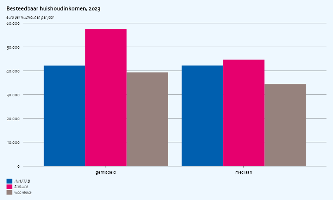
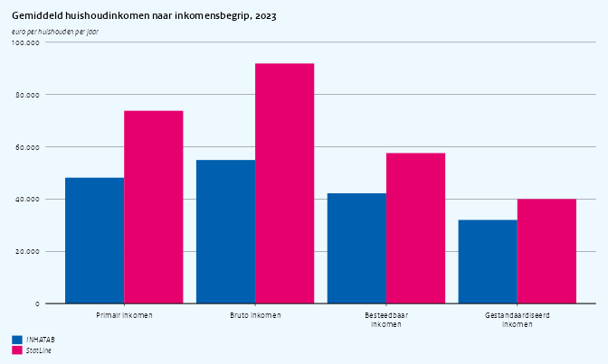
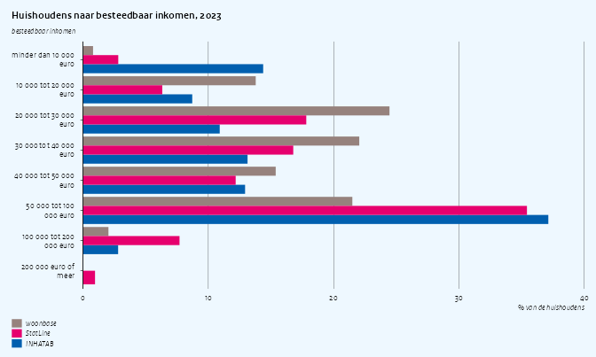
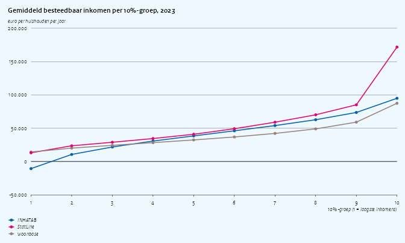
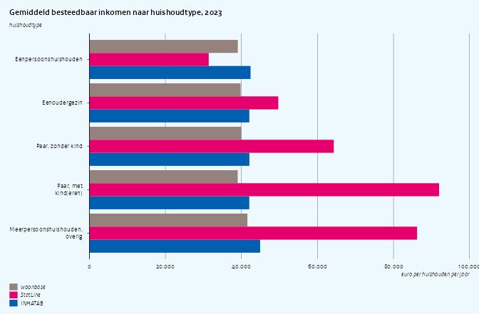

Simulation quality: household income
================

Second vignette in the simulation-quality series (see
`vignette("quality-cars")` for the first). The research question:

> **How unequal is household disposable income in the Netherlands, and
> how does it differ between household types?**

On the real microdata this question is answered with `INHATAB`
(household income, keyed on `RINPERSOONHKW`), linked to the household
composition in woonbase. The simulator offers a second source for the
same quantity: the woonbase extra-kenmerken file
`WOONBASEEKHuishoudensWV`, with `BESTINKH1JAN`. Both are compared here
with StatLine 83932NED, the published aggregate of the same register.

The short version: neither simulated source is usable for this question
yet. `INHATAB` has the wrong unit (one row per person, not per
household), the wrong level, a symmetric distribution where the real one
is skewed, and percentile columns that are unrelated to the income they
rank. The woonbase income has a realistic skewed shape and consistent
percentiles but is too low and does not vary with household type. Code
written against either source runs on the real data unchanged, but the
numbers it produces here carry little information about the real answer.

## Setup

``` r
library(data.table)
library(haven)
library(ggplot2)
library(ggcpb)
library(simcbsradata)  # after haven, so read_sav() is the simulator's
```

`statline()` fetches a StatLine table with the dimension labels added,
retrying a few times on a dropped connection, and returns `NULL` when
StatLine cannot be reached; the plots then show the simulated series
only.

``` r
options(cbsodataR.base_url = "https://opendata.cbs.nl")

statline <- function(id, ..., tries = 3L) {
  for (i in seq_len(tries)) {
    dt <- tryCatch(
      suppressWarnings(as.data.table(cbsodataR::cbs_add_label_columns(
        cbsodataR::cbs_get_data(id, ...)))),
      error = function(e) {
        tcat("StatLine table ", id, " attempt ", i, " failed: ", conditionMessage(e))
        NULL
      })
    if (!is.null(dt)) break
  }
  if (is.null(dt)) return(NULL)
  for (j in names(dt)) {
    if (is.factor(dt[[j]]) || is.character(dt[[j]])) {
      set(dt, j = j, value = trimws(as.character(dt[[j]])))
    }
  }
  dt
}

YEAR <- 2023L
```

### Simulated data

``` r
sim_reset()
woonbase_init(year = YEAR, n = 50000L, seed = 42L)
sim_init("inhatab", year = YEAR, seed = 43L)
sim_init("inpatab", year = YEAR, seed = 44L)

pers <- as.data.table(read_sav(
  sprintf("WoonbasePopulatiePersonen%dV1", YEAR),
  col_select = c(RINPERSOON, HUISHOUDNR1Jan)))
hh <- as.data.table(read_sav(
  sprintf("WoonbasePopulatieHuishoudens%dV1", YEAR),
  col_select = c(RINPERSOON, HUISHOUDNR1Jan, TYPHH1Jan)))
wb_inc <- as.data.table(read_sav(
  sprintf("WOONBASEEKHuishoudensWV%dV1", YEAR),
  col_select = c(RINPERSOON, BESTINKH1JAN, P100HBEST1JAN)))
inpa <- as.data.table(read_sav(
  sprintf("INPA%dTABV1", YEAR),
  col_select = c(RINPERSOON, RINPERSOONHKW, INPPERSBESTINK)))
inha <- as.data.table(read_sav(sprintf("INHA%dTABV1", YEAR)))

hh[, type := as.character(as_factor(TYPHH1Jan))]
# StatLine 83932NED covers private households only
hh <- hh[type != "Institutioneel huishouden"]

# woonbase income: the welvaart file is keyed on the reference person
hh[wb_inc, on = "RINPERSOON", `:=`(
  woonbase  = as.numeric(i.BESTINKH1JAN),
  wb_p100   = as.numeric(i.P100HBEST1JAN))]

# INHATAB: RINPERSOONHKW -> household via INPATAB (person -> HKW) and
# woonbase (person -> household)
inpa[pers, on = "RINPERSOON", HUISHOUDNR1Jan := i.HUISHOUDNR1Jan]
hkw_hh <- unique(inpa[, .(RINPERSOONHKW, HUISHOUDNR1Jan)], by = "RINPERSOONHKW")
```

## One row per household?

`INHATAB` is a household file: on the remote-access environment it has
one row per `RINPERSOONHKW`. The simulated file does not:

``` r
data.table(
  rijen                 = nrow(inha),
  unieke_RINPERSOONHKW  = uniqueN(inha$RINPERSOONHKW),
  huishoudens_woonbase  = nrow(hh)
)
#>    rijen unieke_RINPERSOONHKW huishoudens_woonbase
#> 1: 43952                22227                22919
```

The simulator draws one record per *person* and attaches that person’s
household key, so a household appears once for every member, each time
with a different, independently drawn income:

``` r
dup <- inha[, .N, by = RINPERSOONHKW][N %between% c(2, 4), RINPERSOONHKW[1]]
inha[RINPERSOONHKW == dup, .(RINPERSOONHKW, INHBESTINKH, INHBRUTINKH, INHP100HBEST)]
#>    RINPERSOONHKW INHBESTINKH INHBRUTINKH INHP100HBEST
#> 1:     707664579       70470       48255           86
#> 2:     707664579       -5327        7639           47
#> 3:     707664579       -2140        5337           71
#> 4:     707664579        3602       25091           47
```

Code that aggregates `INHATAB` without deduplicating double-counts
multi-person households, a mistake that cannot happen on the real file.
For the comparison below we keep the first record per household.

``` r
inha1 <- unique(inha, by = "RINPERSOONHKW")
inha1[hkw_hh, on = "RINPERSOONHKW", HUISHOUDNR1Jan := i.HUISHOUDNR1Jan]
hh[inha1, on = "HUISHOUDNR1Jan", `:=`(
  inhatab   = as.numeric(i.INHBESTINKH),
  inh_p100  = as.numeric(i.INHP100HBEST),
  primair   = as.numeric(i.INHPRIMINKH),
  bruto     = as.numeric(i.INHBRUTINKH),
  gestand   = as.numeric(i.INHGESTINKH))]
hh <- hh[!is.na(inhatab)]

# long format: one row per household and simulated source
sim_long <- melt(hh[, .(HUISHOUDNR1Jan, type, inhatab, woonbase)],
  id.vars = c("HUISHOUDNR1Jan", "type"),
  variable.name = "bron", value.name = "inkomen")
sim_long[, bron := fifelse(bron == "inhatab", "INHATAB", "woonbase")]
```

### StatLine reference

| Table    | Content                                                                                                                    |
|----------|----------------------------------------------------------------------------------------------------------------------------|
| 83932NED | Private households by income concept, income class or decile, and household characteristics: count, mean and median income |

``` r
sl <- statline("83932NED", Perioden = paste0(YEAR, "JJ00"))
has_statline <- !is.null(sl)
tcat("StatLine reachable: ", has_statline)
#> [2026-10-19 12:02:48] StatLine reachable: TRUE

if (has_statline) {
  sl[, `:=`(
    n        = as.numeric(ParticuliereHuishoudens_1) * 1000,
    gemiddeld = as.numeric(GemiddeldInkomen_4) * 1000,
    mediaan  = as.numeric(MediaanInkomen_5) * 1000
  )]
  sl_best <- sl[Inkomensbegrippen_label == "Besteedbaar inkomen"]
}
```

## Level: mean and median

``` r
sim_level <- sim_long[, .(gemiddeld = mean(inkomen), mediaan = median(inkomen)), by = bron]
sl_level <- if (has_statline) {
  sl_best[Inkomensklassen_label == "Totaal" &
          KenmerkenVanHuishoudens_label == "Particuliere huishoudens",
          .(bron = "StatLine", gemiddeld, mediaan)]
}
level <- rbindlist(list(sim_level, sl_level), use.names = TRUE)
level
#>        bron gemiddeld mediaan
#> 1:  INHATAB  42216.45 42259.5
#> 2: woonbase  39386.67 34500.0
#> 3: StatLine  57600.00 44700.0

cpb_col(melt(level, id.vars = "bron", variable.name = "maat", value.name = "euro"),
  x = maat, y = euro, fill = bron,
  position       = "dodge",
  reverse_legend = FALSE,
  title = "Besteedbaar huishoudinkomen, 2023",
  ylab  = "euro per huishouden per jaar")
```



Both simulated sources are too low. `INHATAB` draws from a normal
distribution whose mean is set in
`inst/config/datasets/inhatab/params.yaml`; the 2023 values there are
well below the published ones. Because the distribution is symmetric,
its median also equals its mean, whereas in reality the mean lies well
above the median.

The other income concepts in `INHATAB` tell the same story:

``` r
sim_conc <- hh[, .(
  begrip = c("Primair inkomen", "Bruto inkomen", "Besteedbaar inkomen",
             "Gestandaardiseerd inkomen"),
  gemiddeld = c(mean(primair), mean(bruto), mean(inhatab), mean(gestand)),
  bron = "INHATAB")]
sl_conc <- if (has_statline) {
  sl[Inkomensklassen_label == "Totaal" &
     KenmerkenVanHuishoudens_label == "Particuliere huishoudens",
     .(begrip = Inkomensbegrippen_label, gemiddeld, bron = "StatLine")]
}
conc <- rbindlist(list(sim_conc, sl_conc), use.names = TRUE)
conc[, begrip := factor(begrip, levels = unique(sim_conc$begrip))]

cpb_col(conc, x = begrip, y = gemiddeld, fill = bron,
  position       = "dodge",
  reverse_legend = FALSE,
  title = "Gemiddeld huishoudinkomen naar inkomensbegrip, 2023",
  ylab  = "euro per huishouden per jaar")
```



## Distribution over income classes

``` r
KLASSEN <- c("minder dan 10 000 euro", "10 000 tot 20 000 euro",
             "20 000 tot 30 000 euro", "30 000 tot 40 000 euro",
             "40 000 tot 50 000 euro", "50 000 tot 100 000 euro",
             "100 000 tot 200 000 euro", "200 000 euro of meer")
breaks <- c(-Inf, 10, 20, 30, 40, 50, 100, 200, Inf) * 1000

sim_cls <- sim_long[, .N, by = .(bron, klasse = cut(inkomen, breaks, labels = KLASSEN,
                                                    right = FALSE))][
  , .(klasse, aandeel = N / sum(N) * 100), by = bron]
sl_cls <- if (has_statline) {
  sl_best[KenmerkenVanHuishoudens_label == "Particuliere huishoudens" &
          sub("^Inkomen: ", "", Inkomensklassen_label) %in% KLASSEN,
          .(bron = "StatLine", klasse = sub("^Inkomen: ", "", Inkomensklassen_label), n)][
    , .(bron, klasse, aandeel = n / sum(n) * 100)]
}
cls <- rbindlist(list(sim_cls, sl_cls), use.names = TRUE)
cls[, klasse := factor(klasse, levels = rev(KLASSEN))]

cpb_col(cls, x = klasse, y = aandeel, fill = bron,
  position       = "dodge",
  orientation    = "horizontal",
  reverse_legend = TRUE,
  title = "Huishoudens naar besteedbaar inkomen, 2023",
  ylab  = "besteedbaar inkomen",
  xlab  = "% van de huishoudens")
```



`INHATAB` puts far too many households below 10,000 euro: the normal
distribution has a long left tail, truncated at -50,000 euro, so a
sizable share of households gets a large negative income. The real
distribution is right-skewed, with few households at the bottom and a
long tail at the top; the woonbase income has that shape, shifted to the
left.

## Inequality: mean income per decile

The research question is about inequality, so the shape of the
distribution matters more than its level. Mean disposable income per
decile group:

``` r
sim_dec <- sim_long[order(inkomen), .(deciel = ceiling(seq_len(.N) / .N * 10), inkomen),
                    by = bron][, .(gemiddeld = mean(inkomen)), by = .(bron, deciel)]
sl_dec <- if (has_statline) {
  d <- sl_best[KenmerkenVanHuishoudens_label == "Particuliere huishoudens" &
               grepl("10%-groep", Inkomensklassen_label)]
  d[, .(bron = "StatLine",
        deciel = as.integer(sub("^Inkomen: (\\d+)e.*", "\\1", Inkomensklassen_label)),
        gemiddeld)]
}
dec <- rbindlist(list(sim_dec, sl_dec), use.names = TRUE)

cpb_line(dec, x = deciel, y = gemiddeld, colour = bron,
  points = TRUE,
  title = "Gemiddeld besteedbaar inkomen per 10%-groep, 2023",
  ylab  = "euro per huishouden per jaar",
  xlab  = "10%-groep (1 = laagste inkomens)") +
  scale_x_continuous(breaks = 1:10)
```



A common summary is the ratio of the mean income of the top and bottom
decile groups:

``` r
dec[, .(top_bodem = gemiddeld[deciel == 10] / gemiddeld[deciel == 1]), by = bron]
#>        bron top_bodem
#> 1:  INHATAB -8.913554
#> 2: woonbase  6.116032
#> 3: StatLine 13.114504
```

Both sources miss the top of the distribution: the highest decile group
averages well under half of the published value, so any inequality
measure comes out too low. `INHATAB` follows the published decile means
from the third to the ninth group, but its bottom decile has a negative
mean, which makes the ratio meaningless. The woonbase income has a
plausible bottom but falls further behind from the middle upward.

## Percentile columns

Both files ship a precomputed percentile of disposable income
(`INHP100HBEST`, `P100HBEST1JAN`). On the real data that is the rank of
the household in the national distribution, and analyses often group on
it directly instead of computing their own ranks.

``` r
hh[, .(
  bron = c("INHATAB", "woonbase"),
  correlatie_percentiel_inkomen = c(
    cor(inh_p100, inhatab, method = "spearman"),
    cor(wb_p100, woonbase, method = "spearman")))]
#>        bron correlatie_percentiel_inkomen
#> 1:  INHATAB                   -0.01636151
#> 2: woonbase                    0.99994827
```

In `INHATAB` the percentile is drawn independently of the income, so
grouping on it gives flat profiles. In woonbase it is computed from the
income and can be used.

## Income by household type

``` r
TYPEN <- c("Eenpersoonshuishouden", "Eenoudergezin", "Paar, zonder kind",
           "Paar, met kind(eren)", "Meerpersoonshuishouden, overig")
sim_long[, statline_type := fcase(
  type == "Eenpersoonshuishouden",                       "Eenpersoonshuishouden",
  type == "Eenouderhuishouden",                          "Eenoudergezin",
  grepl("paar zonder kinderen", type),                   "Paar, zonder kind",
  grepl("paar met kinderen", type),                      "Paar, met kind(eren)",
  type == "Overig huishouden",                           "Meerpersoonshuishouden, overig"
)]
sim_type <- sim_long[!is.na(statline_type),
                     .(gemiddeld = mean(inkomen)), by = .(bron, type = statline_type)]
sl_type <- if (has_statline) {
  sl_best[Inkomensklassen_label == "Totaal" &
          sub("^Type: ", "", KenmerkenVanHuishoudens_label) %in% TYPEN,
          .(bron = "StatLine", type = sub("^Type: ", "", KenmerkenVanHuishoudens_label),
            gemiddeld)]
}
by_type <- rbindlist(list(sim_type, sl_type), use.names = TRUE)
by_type[, type := factor(type, levels = rev(TYPEN))]

cpb_col(by_type, x = type, y = gemiddeld, fill = bron,
  position       = "dodge",
  orientation    = "horizontal",
  reverse_legend = TRUE,
  title = "Gemiddeld besteedbaar inkomen naar huishoudtype, 2023",
  ylab  = "huishoudtype",
  xlab  = "euro per huishouden per jaar")
```



In reality couples with children have roughly three times the disposable
income of single-person households. Neither simulated source reproduces
that: `INHATAB` draws income independently of the household, and
woonbase links it to the WOZ value of the dwelling only, not to the
number of earners.

## Persons and households

Household income is the sum of the incomes of its members. A natural
consistency check, and a common step in research code, is to aggregate
`INPATAB` to the household and compare:

``` r
pers_sum <- inpa[, .(som_personen = sum(as.numeric(INPPERSBESTINK))), by = RINPERSOONHKW]
pers_sum[inha1, on = "RINPERSOONHKW", inhatab := as.numeric(i.INHBESTINKH)]
pers_sum[, .(huishoudens = .N, correlatie = cor(som_personen, inhatab))]
#>    huishoudens  correlatie
#> 1:       22227 -0.00428995
```

The two files are generated independently, so the household total of the
person incomes has no relation to the household income.

## Summary

| Moment                           | Source in simulator                 | Matches StatLine?                                 | Safe for research? |
|----------------------------------|-------------------------------------|---------------------------------------------------|--------------------|
| One row per household in INHATAB | one row per person                  | no                                                | no                 |
| Mean / median income (INHATAB)   | normal, hand-set params             | no, too low; median = mean                        | no                 |
| Mean / median income (woonbase)  | lognormal via WOZ rank              | too low                                           | no                 |
| Distribution over classes        | INHATAB normal / woonbase lognormal | no / shape roughly                                | no                 |
| Inequality (decile means)        | as above                            | no: top too low (both), bottom negative (INHATAB) | no                 |
| Percentile columns               | INHATAB uniform / woonbase rank     | no / yes                                          | woonbase only      |
| Income by household type         | independent of type                 | no                                                | no                 |
| Persons add up to households     | independent files                   | no                                                | no                 |

For this research question the simulator is useful for building and
testing the pipeline (linking `INHATAB` via `RINPERSOONHKW`, joining
household types, computing deciles), as long as the code deduplicates on
`RINPERSOONHKW`. The inequality and household-type results themselves
have to come from the real microdata. The main improvements that would
change that verdict: one `INHATAB` row per household, a skewed
distribution calibrated to the 83932NED deciles, income conditional on
household type, and income concepts and percentiles derived from one
another rather than drawn independently.
