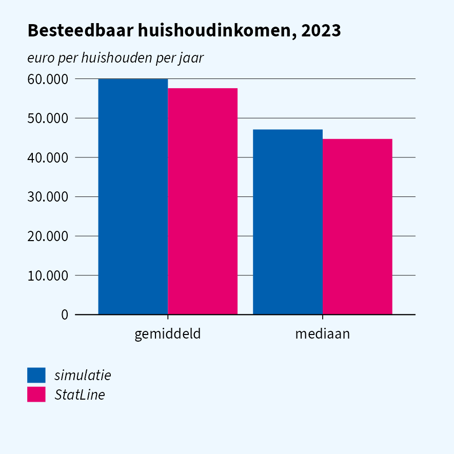
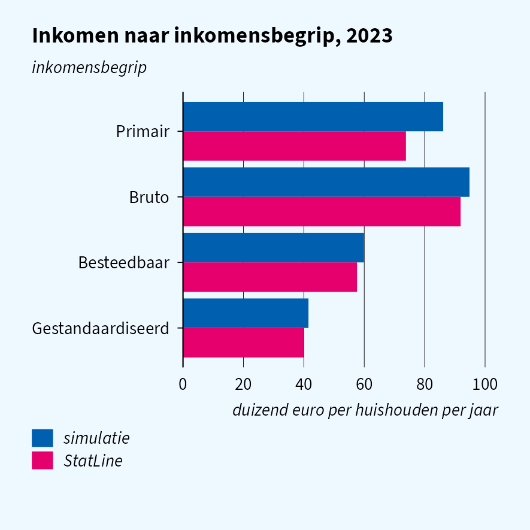
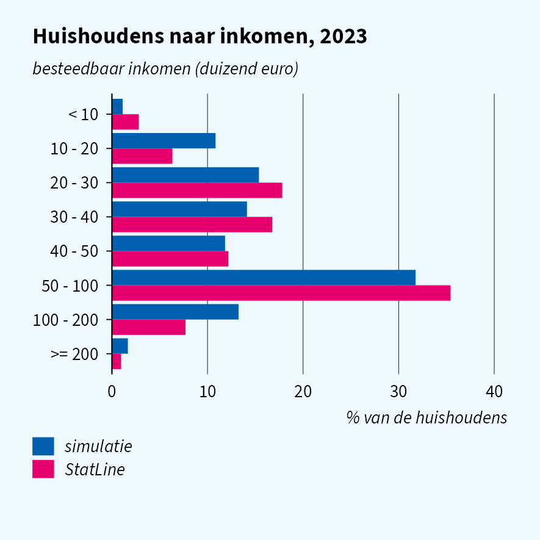
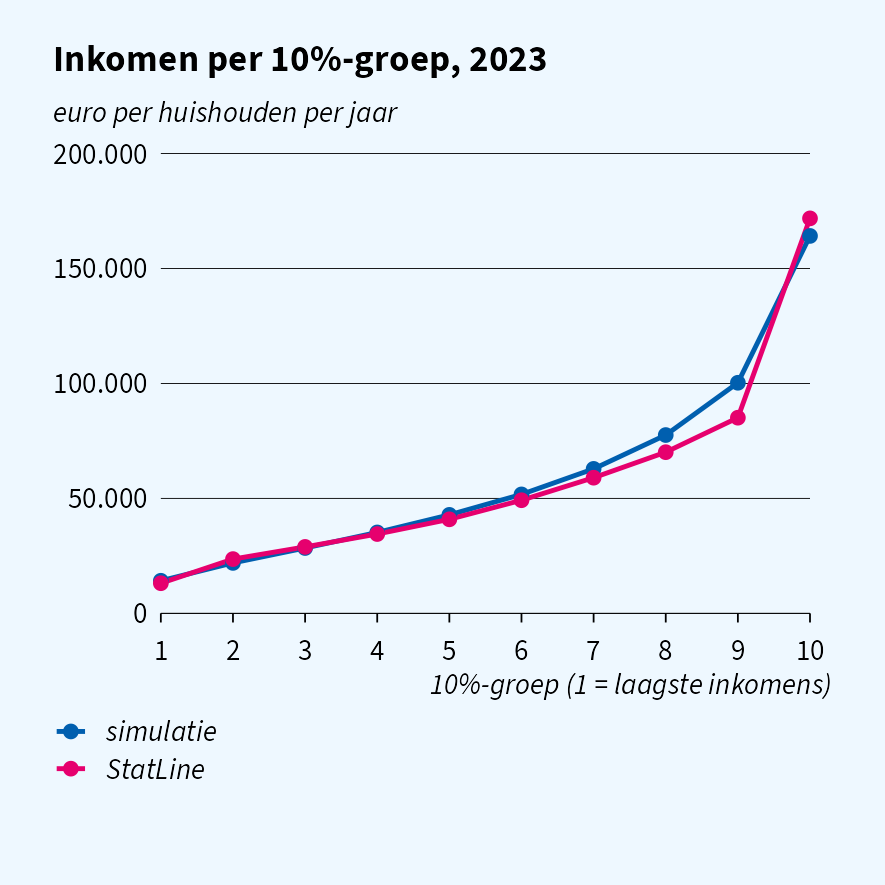
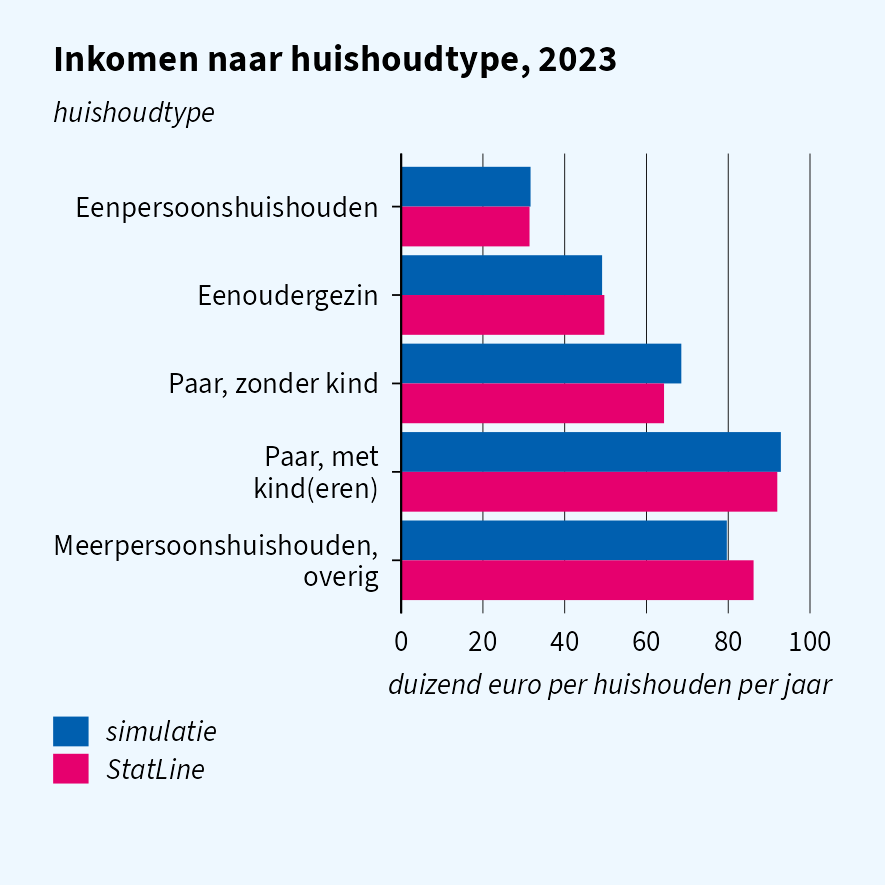

Simulation quality: household income
================

Second vignette in the simulation-quality series (see
`vignette("quality-cars")` for the first). The research question:

> **How unequal is household disposable income in the Netherlands, and
> how does it differ between household types?**

On the real microdata this question is answered with `INHATAB`
(household income, keyed on `RINPERSOONHKW`), linked to the household
composition in woonbase. The simulator offers a second source for the
same quantity: the woonbase extra-kenmerken file
`WOONBASEEKHuishoudensWV`, with `BESTINKH1JAN`. Both are compared here
with StatLine 83932NED, the published aggregate of the same register.

The short version: household income is drawn per household type from
83932NED, and both simulated sources hold the same value. The published
level and the differences between household types are reproduced, and
the distribution over income classes and the decile means come close,
with somewhat too little mass at the very bottom and in the extreme top.
One gap remains: personal incomes in `INPATAB` are drawn independently
and do not add up to the household income.

## Setup

``` r
library(data.table)
library(haven)
library(ggplot2)
library(ggcpb)
library(simregdata)  # after haven, so read_sav() is the simulator's
```

Figures are written with `save_cpb()` at the CPB page width (half page,
7.5 cm, unless noted) and shown at half size, as in the ggcpb vignettes.
They use ggcpb’s open fallback font, Source Sans 3, instead of the
Rijksoverheid font.

``` r
options(ggcpb.font_path = character(0), ggcpb.font_warning = FALSE)
cpb_register_fonts(enable_showtext = FALSE)

# write `p` with save_cpb() next to knitr's own figures and include it
show_cpb <- function(p, name, page = "half", height = NULL) {
  file <- file.path(dirname(knitr::fig_path()), paste0(name, ".png"))
  dir.create(dirname(file), recursive = TRUE, showWarnings = FALSE)
  save_cpb(file, p, page = page, height = height)
  knitr::include_graphics(file)
}

# horizontal bars: first category at the top, simulatie above StatLine
# (pass colour_index = c(2, 6) to keep the colours of the other figures)
flip <- function(d, x) {
  d <- copy(d)
  d[, (x) := factor(get(x), levels = rev(levels(factor(get(x)))))]
  d[, bron := factor(bron, levels = c("StatLine", "simulatie"))]
  d
}
```

`statline()` fetches a StatLine table with the dimension labels added,
retrying a few times on a dropped connection, and returns `NULL` when
StatLine cannot be reached; the plots then show the simulated series
only.

``` r
options(cbsodataR.base_url = "https://opendata.cbs.nl")

statline <- function(id, ..., tries = 3L) {
  for (i in seq_len(tries)) {
    dt <- tryCatch(
      suppressWarnings(as.data.table(cbsodataR::cbs_add_label_columns(
        cbsodataR::cbs_get_data(id, ...)))),
      error = function(e) {
        tcat("StatLine table ", id, " attempt ", i, " failed: ", conditionMessage(e))
        NULL
      })
    if (!is.null(dt)) break
  }
  if (is.null(dt)) return(NULL)
  for (j in names(dt)) {
    if (is.factor(dt[[j]]) || is.character(dt[[j]])) {
      set(dt, j = j, value = trimws(as.character(dt[[j]])))
    }
  }
  dt
}

YEAR <- 2023L
```

### Simulated data

``` r
sim_reset()
woonbase_init(year = YEAR, n = 50000L, seed = 42L)
sim_init("inhatab", year = YEAR, seed = 43L)
sim_init("inpatab", year = YEAR, seed = 44L)

pers <- as.data.table(read_sav(
  sprintf("WoonbasePopulatiePersonen%dV1", YEAR),
  col_select = c(RINPERSOON, HUISHOUDNR1Jan)))
hh <- as.data.table(read_sav(
  sprintf("WoonbasePopulatieHuishoudens%dV1", YEAR),
  col_select = c(RINPERSOON, HUISHOUDNR1Jan, TYPHH1Jan)))
wb_inc <- as.data.table(read_sav(
  sprintf("WOONBASEEKHuishoudensWV%dV1", YEAR),
  col_select = c(RINPERSOON, BESTINKH1JAN, P100HBEST1JAN)))
inpa <- as.data.table(read_sav(
  sprintf("INPA%dTABV1", YEAR),
  col_select = c(RINPERSOON, RINPERSOONHKW, INPPERSBESTINK)))
inha <- as.data.table(read_sav(sprintf("INHA%dTABV1", YEAR)))

hh[, type := as.character(as_factor(TYPHH1Jan))]
# StatLine 83932NED covers private households only
hh <- hh[type != "Institutioneel huishouden"]

# woonbase income: the welvaart file is keyed on the reference person
hh[wb_inc, on = "RINPERSOON", `:=`(
  woonbase  = as.numeric(i.BESTINKH1JAN),
  wb_p100   = as.numeric(i.P100HBEST1JAN))]

# INHATAB: RINPERSOONHKW -> household via INPATAB (person -> HKW) and
# woonbase (person -> household)
inpa[pers, on = "RINPERSOON", HUISHOUDNR1Jan := i.HUISHOUDNR1Jan]
hkw_hh <- unique(inpa[, .(RINPERSOONHKW, HUISHOUDNR1Jan)], by = "RINPERSOONHKW")
inha[hkw_hh, on = "RINPERSOONHKW", HUISHOUDNR1Jan := i.HUISHOUDNR1Jan]
hh[inha, on = "HUISHOUDNR1Jan", `:=`(
  inhatab   = as.numeric(i.INHBESTINKH),
  inh_p100  = as.numeric(i.INHP100HBEST),
  primair   = as.numeric(i.INHPRIMINKH),
  bruto     = as.numeric(i.INHBRUTINKH),
  gestand   = as.numeric(i.INHGESTINKH))]
hh <- hh[!is.na(inhatab)]
```

## One row per household

`INHATAB` is a household file: on the remote-access environment it has
one row per `RINPERSOONHKW`. The simulated file follows that, and every
household key in `INPATAB` is found in it:

``` r
data.table(
  rijen                   = nrow(inha),
  unieke_RINPERSOONHKW    = uniqueN(inha$RINPERSOONHKW),
  inpatab_hkw_in_inhatab  = mean(inpa$RINPERSOONHKW %in% inha$RINPERSOONHKW) * 100
)
#>    rijen unieke_RINPERSOONHKW inpatab_hkw_in_inhatab
#> 1: 22227                22227                    100
```

Both simulated sources carry the same disposable income for a household,
so an analysis gives the same answer whichever file it starts from:

``` r
hh[!is.na(woonbase), .(huishoudens = .N, gelijk = mean(inhatab == woonbase) * 100)]
#>    huishoudens gelijk
#> 1:       21890    100
```

The rest of this vignette uses `INHATAB`.

### StatLine reference

| Table    | Content                                                                                                                    |
|----------|----------------------------------------------------------------------------------------------------------------------------|
| 83932NED | Private households by income concept, income class or decile, and household characteristics: count, mean and median income |

The simulator is calibrated to the mean and median per household type of
this table (`inhatab_update_params()`); the class distribution, the
decile means and the national totals below are not used in the
calibration and are an out-of-sample check.

``` r
sl <- statline("83932NED", Perioden = paste0(YEAR, "JJ00"))
has_statline <- !is.null(sl)
tcat("StatLine reachable: ", has_statline)
#> [2026-10-23 10:06:35] StatLine reachable: TRUE

if (has_statline) {
  sl[, `:=`(
    n         = as.numeric(ParticuliereHuishoudens_1) * 1000,
    gemiddeld = as.numeric(GemiddeldInkomen_4) * 1000,
    mediaan   = as.numeric(MediaanInkomen_5) * 1000
  )]
  sl_best <- sl[Inkomensbegrippen_label == "Besteedbaar inkomen"]
}
```

## Level: mean and median

``` r
sim_level <- hh[, .(bron = "simulatie", gemiddeld = mean(inhatab), mediaan = median(inhatab))]
sl_level <- if (has_statline) {
  sl_best[Inkomensklassen_label == "Totaal" &
          KenmerkenVanHuishoudens_label == "Particuliere huishoudens",
          .(bron = "StatLine", gemiddeld, mediaan)]
}
level <- rbindlist(list(sim_level, sl_level), use.names = TRUE)
level
#>         bron gemiddeld mediaan
#> 1: simulatie  59915.66   47100
#> 2:  StatLine  57600.00   44700

p <- cpb_col(melt(level, id.vars = "bron", variable.name = "maat", value.name = "euro"),
  x = maat, y = euro, fill = bron,
  position       = "dodge",
  reverse_legend = FALSE,
  title = "Besteedbaar huishoudinkomen, 2023",
  ylab  = "euro per huishouden per jaar")
show_cpb(p, "level")
#> [2026-10-23 10:06:35] ggcpb: wrote quality-income_files/figure-gfm/level.png (2.95 x 2.95 in, 300 dpi)
```



The other income concepts are derived from disposable income per
household, using the ratio of the type’s medians:

``` r
sim_conc <- hh[, .(
  begrip = c("Primair inkomen", "Bruto inkomen", "Besteedbaar inkomen",
             "Gestandaardiseerd inkomen"),
  gemiddeld = c(mean(primair), mean(bruto), mean(inhatab), mean(gestand)),
  bron = "simulatie")]
sl_conc <- if (has_statline) {
  sl[Inkomensklassen_label == "Totaal" &
     KenmerkenVanHuishoudens_label == "Particuliere huishoudens",
     .(begrip = Inkomensbegrippen_label, gemiddeld, bron = "StatLine")]
}
conc <- rbindlist(list(sim_conc, sl_conc), use.names = TRUE)
conc[, begrip := factor(begrip, levels = unique(sim_conc$begrip))]

conc[, begrip := factor(sub(" inkomen$", "", begrip), levels = sub(" inkomen$", "", levels(begrip)))]
p <- cpb_col(flip(conc[, .(begrip, bron, duizend = gemiddeld / 1000)], "begrip"),
  x = begrip, y = duizend, fill = bron,
  colour_index = c(2, 6),  # keep simulatie blue, StatLine magenta
  position    = "dodge",
  orientation = "horizontal",
  title = "Inkomen naar inkomensbegrip, 2023",
  ylab  = "inkomensbegrip",
  xlab  = "duizend euro per huishouden per jaar")
show_cpb(p, "concepts")
#> [2026-10-23 10:06:36] ggcpb: wrote quality-income_files/figure-gfm/concepts.png (2.95 x 2.95 in, 300 dpi)
```



Gross and standardised income follow; primary income comes out too high,
because it is far more skewed than disposable income (pensioners have
little primary income) and a single ratio of medians does not capture
that.

## Distribution over income classes

``` r
KLASSEN <- c("minder dan 10 000 euro", "10 000 tot 20 000 euro",
             "20 000 tot 30 000 euro", "30 000 tot 40 000 euro",
             "40 000 tot 50 000 euro", "50 000 tot 100 000 euro",
             "100 000 tot 200 000 euro", "200 000 euro of meer")
breaks <- c(-Inf, 10, 20, 30, 40, 50, 100, 200, Inf) * 1000

sim_cls <- hh[, .N, by = .(klasse = cut(inhatab, breaks, labels = KLASSEN, right = FALSE))][
  , .(bron = "simulatie", klasse, aandeel = N / sum(N) * 100)]
sl_cls <- if (has_statline) {
  sl_best[KenmerkenVanHuishoudens_label == "Particuliere huishoudens" &
          sub("^Inkomen: ", "", Inkomensklassen_label) %in% KLASSEN,
          .(bron = "StatLine", klasse = sub("^Inkomen: ", "", Inkomensklassen_label), n)][
    , .(bron, klasse, aandeel = n / sum(n) * 100)]
}
cls <- rbindlist(list(sim_cls, sl_cls), use.names = TRUE)
# short labels for the figure, in thousands of euro
KORT <- c("< 10", "10 - 20", "20 - 30", "30 - 40", "40 - 50", "50 - 100",
          "100 - 200", ">= 200")
cls[, klasse := factor(KORT[match(klasse, KLASSEN)], levels = KORT)]

p <- cpb_col(flip(cls, "klasse"), x = klasse, y = aandeel, fill = bron,
  colour_index = c(2, 6),  # keep simulatie blue, StatLine magenta
  position    = "dodge",
  orientation = "horizontal",
  title = "Huishoudens naar inkomen, 2023",
  ylab  = "besteedbaar inkomen (duizend euro)",
  xlab  = "% van de huishoudens")
show_cpb(p, "classes")
#> [2026-10-23 10:06:36] ggcpb: wrote quality-income_files/figure-gfm/classes.png (2.95 x 2.95 in, 300 dpi)
```



The lognormal per household type gets the bulk of the distribution right
but has thin tails at the bottom: hardly any household falls below
10,000 euro, where the real data hold self-employed with losses and
students. In return too many households land between 100,000 and 200,000
euro.

## Inequality: mean income per decile

The research question is about inequality, so the shape of the
distribution matters more than its level. Mean disposable income per
decile group:

``` r
sim_dec <- hh[order(inhatab), .(deciel = ceiling(seq_len(.N) / .N * 10), inhatab)][
  , .(bron = "simulatie", gemiddeld = mean(inhatab)), by = deciel]
sl_dec <- if (has_statline) {
  d <- sl_best[KenmerkenVanHuishoudens_label == "Particuliere huishoudens" &
               grepl("10%-groep", Inkomensklassen_label)]
  d[, .(bron = "StatLine",
        deciel = as.integer(sub("^Inkomen: (\\d+)e.*", "\\1", Inkomensklassen_label)),
        gemiddeld)]
}
dec <- rbindlist(list(sim_dec, sl_dec), use.names = TRUE)

p <- cpb_line(dec, x = deciel, y = gemiddeld, colour = bron,
  points = TRUE,
  title = "Inkomen per 10%-groep, 2023",
  ylab  = "euro per huishouden per jaar",
  xlab  = "10%-groep (1 = laagste inkomens)") +
  scale_x_continuous(breaks = 1:10)
show_cpb(p, "deciles")
#> [2026-10-23 10:06:37] ggcpb: wrote quality-income_files/figure-gfm/deciles.png (2.95 x 2.95 in, 300 dpi)
```



A common summary is the ratio of the mean income of the top and bottom
decile groups:

``` r
dec[, .(top_bodem = gemiddeld[deciel == 10] / gemiddeld[deciel == 1]), by = bron]
#>         bron top_bodem
#> 1: simulatie   11.5816
#> 2:  StatLine   13.1145
```

The decile means follow the published ones up to the eighth group. The
ninth is too high and the tenth too low: the real top decile has a much
longer tail than a lognormal, so inequality measures that weigh the very
top (the top-bottom ratio, top income shares) come out somewhat too low.

## Percentile columns

`INHP100HBEST` is the household’s rank in the national distribution of
disposable income, as on the real file, so grouping on it directly is
equivalent to computing the ranks yourself:

``` r
hh[, .(correlatie_percentiel_inkomen = cor(inh_p100, inhatab, method = "spearman"))]
#>    correlatie_percentiel_inkomen
#> 1:                      0.999949
```

## Income by household type

``` r
TYPEN <- c("Eenpersoonshuishouden", "Eenoudergezin", "Paar, zonder kind",
           "Paar, met kind(eren)", "Meerpersoonshuishouden, overig")
hh[, statline_type := fcase(
  type == "Eenpersoonshuishouden",     "Eenpersoonshuishouden",
  type == "Eenouderhuishouden",        "Eenoudergezin",
  grepl("paar zonder kinderen", type), "Paar, zonder kind",
  grepl("paar met kinderen", type),    "Paar, met kind(eren)",
  type == "Overig huishouden",         "Meerpersoonshuishouden, overig"
)]
sim_type <- hh[!is.na(statline_type),
               .(bron = "simulatie", gemiddeld = mean(inhatab)), by = .(type = statline_type)]
sl_type <- if (has_statline) {
  sl_best[Inkomensklassen_label == "Totaal" &
          sub("^Type: ", "", KenmerkenVanHuishoudens_label) %in% TYPEN,
          .(bron = "StatLine", type = sub("^Type: ", "", KenmerkenVanHuishoudens_label),
            gemiddeld)]
}
by_type <- rbindlist(list(sim_type, sl_type), use.names = TRUE)
by_type[, type := factor(type, levels = TYPEN)]

p <- cpb_col(flip(by_type[, .(type, bron, duizend = gemiddeld / 1000)], "type"),
  x = type, y = duizend, fill = bron,
  colour_index = c(2, 6),  # keep simulatie blue, StatLine magenta
  position       = "dodge",
  orientation    = "horizontal",
  reverse_legend = TRUE,
  title = "Inkomen naar huishoudtype, 2023",
  ylab  = "huishoudtype",
  xlab  = "duizend euro per huishouden per jaar")
show_cpb(p, "by-type")
#> [2026-10-23 10:06:37] ggcpb: wrote quality-income_files/figure-gfm/by-type.png (2.95 x 2.95 in, 300 dpi)
```



The calibration targets are finer than these five groups (singles and
childless couples are split at the AOW age), so the means here are a
check that the household types in the simulated population are combined
in the right proportions.

## Persons and households

Household income is the sum of the incomes of its members. A natural
consistency check, and a common step in research code, is to aggregate
`INPATAB` to the household and compare:

``` r
pers_sum <- inpa[, .(som_personen = sum(as.numeric(INPPERSBESTINK))), by = RINPERSOONHKW]
pers_sum[inha, on = "RINPERSOONHKW", inhatab := as.numeric(i.INHBESTINKH)]
pers_sum[, .(huishoudens = .N, correlatie = cor(som_personen, inhatab))]
#>    huishoudens correlatie
#> 1:       22227  0.1828951
```

Personal incomes in `INPATAB` are still drawn independently of the
household, so the household total of the person incomes is only weakly
related to the household income, through the number of members. Analyses
that split household income over its members, or that combine personal
and household income, cannot be checked on the simulated data yet.

## Summary

| Moment                           | Source in simulator                | Matches StatLine?                         | Safe for research?     |
|----------------------------------|------------------------------------|-------------------------------------------|------------------------|
| One row per household in INHATAB | household spine                    | yes                                       | yes                    |
| INHATAB and woonbase agree       | same spine column                  | yes                                       | yes                    |
| Mean / median income             | lognormal per type, 83932NED       | yes                                       | yes                    |
| Other income concepts            | derived from disposable income     | gross, standardised yes; primary too high | not for primary income |
| Distribution over classes        | lognormal mixture (not calibrated) | close; tails too thin                     | yes, except the tails  |
| Inequality (decile means)        | lognormal mixture (not calibrated) | close up to decile 8; top too low         | with care at the top   |
| Percentile columns               | rank of the income                 | yes                                       | yes                    |
| Income by household type         | 83932NED per type                  | yes                                       | yes                    |
| Persons add up to households     | INPATAB independent                | no                                        | no                     |

For this research question the simulator now gives answers close to the
published figures, so results developed here are a reasonable preview of
the results on the real microdata, with inequality at the very top
somewhat understated. What it cannot show is anything finer than the
calibration: income differences by region, education or migration
background, and the split of household income over its members.
